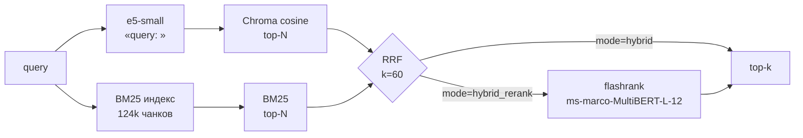

# 1C MCP RAG Search

[](https://github.com/Smaturus/1c-mcp-rag-search/actions/workflows/ci.yml)
[](https://github.com/Smaturus/1c-mcp-rag-search/releases/latest)


Поисковый слой для выгрузки 1С, доступный LLM-агенту через **MCP**: находит нужную
бизнес-логику по BSL-коду и по отчёту конфигурации, даже если точное имя неизвестно.
Всё работает локально без внешних API, данные не покидают машину.

Внутри — гибридный retrieval (semantic + lexical), измеренный на собственном
gold-set, с документированными архитектурными решениями и CI.

| Показатель | Значение |
|---|---|
| Индекс | **124 253** чанка (код + метаданные) |
| Лексический индекс | глобальный BM25: **233 515** термов, 6,1 млн постингов, 51 МБ |
| Качество (nDCG@10) | **0.209 ± 0.003** у hybrid против 0.176 у чистого cosine (+19 %), gold-set v2: 70 естественных запросов |
| Латентность | **40–60 мс** на запрос (CPU, без GPU) |
| Инженерные проверки | 39 unit-тестов, `ruff`, `mypy`, CI на Python 3.11/3.12 |

## Задача

Выгрузка 1С — это тысячи `.bsl`-модулей и отчёт на десятки мегабайт. Разработчику
нужно быстро найти, где реализована конкретная логика, а LLM-агенту — надёжный
инструмент поиска вместо `grep`.

Проект решает две задачи:

1. **протокол** — MCP-сервер со стандартными инструментами для любого MCP-клиента;
2. **качество** — воспроизводимый retrieval-пайплайн с метриками и обоснованными
   архитектурными решениями, а не «поиск, который просто работает».

## Как это работает



Два независимых сигнала — семантический (cosine по e5-small) и лексический
(глобальный BM25) — объединяются через **Reciprocal Rank Fusion** по рангам.
Cross-encoder подключается опционально как второй этап.

Подробнее — [docs/ARCHITECTURE.md](docs/ARCHITECTURE.md).

## Быстрый старт

```powershell
git clone https://github.com/Smaturus/1c-mcp-rag-search.git
cd 1c-mcp-rag-search
py -3.12 -m venv .venv
.\.venv\Scripts\Activate.ps1
pip install -e ".[dev]"

# 1) индекс по локальной выгрузке 1С (пути — ниже)
python -m mcp_1c_rag.indexer --reset

# 2) лексический индекс для RRF
python scripts\build_bm25.py

# 3) проверка качества
python scripts\make_goldset.py
python scripts\eval_pipeline.py
python scripts\bench.py
```

Первый запуск скачивает модель `intfloat/multilingual-e5-small` в кэш HuggingFace.

## MCP-инструменты

| Tool | Назначение |
|---|---|
| `codesearch(query, limit=5)` | семантический поиск по `.bsl` (cosine baseline) |
| `metadatasearch(query, limit=20)` | поиск по отчёту конфигурации (`.txt`) |
| `search(query, top_k, mode, collection)` | единый пайплайн: `vector` / `hybrid` (RRF) / `hybrid_rerank` / `pearson` |
| `evaluate_retrieval(query, k, …)` | метрики по одному запросу: Hit@k, Recall@k, MRR, nDCG, null-tail |

Стек: **MCP Python SDK 2.x (`MCPServer`)** + **Chroma** + **`intfloat/multilingual-e5-small`**
+ собственный BM25/инвертированный индекс + **flashrank** (опция).

## Retrieval pipeline

Единая точка входа — `search(query, top_k, mode)` в
[src/mcp_1c_rag/search_modes.py](src/mcp_1c_rag/search_modes.py).

| Режим | Что делает | Латентность |
|---|---|---|
| `vector` | только cosine (baseline) | ~35–50 мс |
| `pearson` | взвешенный `cos + BM25 + Pearson` (исторический baseline) | ~60 мс |
| `hybrid` | cosine + глобальный BM25 через **RRF** (по умолчанию) | ~40–50 мс |
| `hybrid_rerank` | RRF + cross-encoder вторым этапом | ~1,1 с (eval) / p50 ~6 с (bench) |

Ключевые свойства:

- **RRF по рангам**, а не по сырым скорам: `score(d) = Σ 1/(k_rrf + rank_i(d))`, `k_rrf = 60`;
- **глобальный BM25** по всем 124 253 чанкам (инвертированный индекс, 51 МБ, сборка ~9 с);
- токенизация под 1С: кириллица, цифры, дефисные коды (`НФ-001`, `НДС-18`);
- префиксы e5 (`query: ` / `passage: `) сохраняются: запрос кодируется `embed_query`,
  документы — индексатором;
- reranker **не заменяет** e5-small, а переупорядочивает 20 кандидатов RRF;
- параметры (модель, `top_k`, `k_rrf`, `max_length`) — переменные окружения в
  [config.py](src/mcp_1c_rag/config.py), без правки кода.

```powershell
# собрать лексический индекс (один раз)
python scripts\build_bm25.py

# вызвать из кода
python -c "from mcp_1c_rag.search_modes import search; print(search('НДС с аванса', top_k=3, mode='hybrid'))"
```

## Оценка качества

Основной набор — **gold-set v2: 70 запросов в естественных формулировках**
(30 курируемых доменных вопросов + 40 по реальным объектам конфигурации;
`exact` / `semantic` / `trap`). Релевантность — **на уровне файла-источника**,
схлопывание повторных чанков перед расчётом метрик (ADR 0003–0005).

```powershell
python scripts\make_goldset_v2.py
python scripts\eval_pipeline.py --golden data\eval\gold_set_v2.jsonl --out-dir data\eval\v2
# воспроизводимость: несколько прогонов + агрегатор mean ± std
python scripts\eval_stability.py --out-dir data\eval\v2
```

Замеры: mean ± std по 3 независимым прогонам (reranker — однократно из-за стоимости).
Каждый прогон — новый процесс: HNSW пересобирается при старте, поэтому разброс
показывает устойчивость метрики.

| Конфигурация | Hit@1 | MRR@10 | nDCG@10 | Recall@10 | мс/запрос |
|---|---|---|---|---|---|
| `vector` | 0.076 ± 0.007 | 0.127 ± 0.005 | 0.176 ± 0.005 | 0.310 ± 0.015 | ~56 |
| `pearson` | 0.090 ± 0.007 | 0.139 ± 0.002 | 0.194 ± 0.006 | 0.348 ± 0.026 | ~99 |
| **`hybrid` (RRF)** | **0.090 ± 0.007** | **0.158 ± 0.003** | **0.209 ± 0.003** | **0.352 ± 0.007** | **~63** |
| `hybrid_rerank` | 0.014 | 0.047 | 0.069 | 0.136 | ~1100 |

**Выводы:**

1. **RRF-гибрид лучший** по nDCG@10 (+19 %), MRR@10 (+24 %) и Recall@10 (+14 %)
   относительно чистого cosine, при сопоставимой латентности. Разброс гибрида
   (±0.003) заметно меньше, чем у vector (±0.005) — результат устойчив.
2. **На естественных запросах разрыв меньше, чем на v1** (+19 % против +39 %):
   semantic-baseline на реальных формулировках работает лучше, и вклад лексики
   скромнее. Выбор hybrid не меняется, но заявленный эффект честно уменьшен.
3. **Pearson** даёт прирост только над cosine (0.194 против 0.176), но проигрывает
   RRF и работает медленнее — оставлен baseline-режимом.
4. **Cross-encoder reranker ухудшает качество** и на v2 (0.209 → 0.069), и на порядок
   медленнее. Причина, вероятно, в домене: модель обучена на веб-пассажах, а BSL —
   длинный повторяющийся код. Режим оставлен опцией; решение — ADR 0002.
5. Абсолютные значения всё ещё скромные (nDCG@10 ≈ 0.21): e5-small не обучен на
   коде, а авточасть набора шаблонная. Это зафиксировано, а не замаскировано;
   следующий шаг — chunking по процедурам и код-ориентированные эмбеддинги.
6. Методика eval прошла два внешних ревью: исправлен учёт повторных чанков
   (ADR 0004, цифры 0.378 → 0.199 на v1) и собран natural-набор (ADR 0005).

Сравнение с первой версией набора (30 запросов, шаблонные формулировки):

| Конфигурация | v1 nDCG@10 | v2 nDCG@10 | v1 MRR@10 | v2 MRR@10 |
|---|---|---|---|---|
| `vector` | 0.143 | **0.176** | 0.109 | 0.127 |
| `pearson` | 0.165 | **0.194** | 0.148 | 0.139 |
| `hybrid` | 0.199 | **0.209** | 0.183 | 0.158 |
| `hybrid_rerank` | 0.078 | 0.069 | 0.048 | 0.047 |

## Воспроизводимость

| Параметр | Значение |
|---|---|
| Embedding | `intfloat/multilingual-e5-small` (env `MCP_1C_EMBEDDING_MODEL`) |
| HNSW space | cosine (`store.py`) |
| BM25 | собственный инвертированный индекс (`bm25.py`), `k1=1.5`, `b=0.75` |
| RRF | `k_rrf = 60` (`MCP_1C_RRF_K`) |
| Дефолтный режим | `hybrid` (`MCP_1C_SEARCH_MODE`) |
| Commit индексатора | [`a1f42eb`](https://github.com/Smaturus/1c-mcp-rag-search/commit/a1f42eb) |

## Требования и установка

- Windows / Linux / macOS, Python **3.11–3.12** (на 3.14 может не быть колёс
  для `torch` / `chromadb`).
- Локальные источники (пути задаются env):
  - выгрузка конфигурации — дерево с `.bsl`;
  - отчёт по конфигурации — `.txt`.
- 2+ ГБ на модель и индекс; для полной индексации — 6–8 ГБ RAM.

```powershell
cd <корень-репозитория>
py -3.12 -m venv .venv
.\.venv\Scripts\Activate.ps1
python -m pip install -U pip
pip install -e ".[dev]"
```

## Индексация

```powershell
$env:MCP_1C_STUDY_ROOT="D:\Study"                 # дерево .bsl
$env:MCP_1C_STUDY_REPORT_ROOT="D:\Study_Report"  # отчёт конфигурации

python -m mcp_1c_rag.indexer --reset
python scripts\build_bm25.py
```

Smoke-режим (ограничить объём):

```powershell
python -m mcp_1c_rag.indexer --target code --reset --limit 30 --max-chunks 200
python -m mcp_1c_rag.indexer --target metadata --reset --max-chunks 200
```

Индекс: `data/chroma/` (в `.gitignore`). Другие переменные: `MCP_1C_CHROMA_DIR`,
`MCP_1C_EMBED_BATCH_SIZE`.

## Подключение к клиенту

В `mcp.json` (Cursor) или `mcp.servers` (ZCode) добавить сервер:

```json
"1c-mcp-rag-search": {
  "command": "D:\\path\\to\\repo\\.venv\\Scripts\\python.exe",
  "args": ["-m", "mcp_1c_rag"]
}
```

Перезапустить клиент — появятся tools `codesearch`, `metadatasearch`, `search`,
`evaluate_retrieval`.

Проверка без клиента:

```powershell
python -c "from mcp_1c_rag.search import codesearch, metadatasearch; print(codesearch('Провести', 3)); print(metadatasearch('Справочник', 3))"
```

## Архитектурные решения

| Решение | Альтернатива | Почему выбрали | Данные |
|---|---|---|---|
| **RRF-гибрид — основной пайплайн**, Pearson — baseline | Взвешенный `cos+BM25+Pearson` | nDCG@10 0.194 → 0.209, MRR@10 0.139 → 0.158 (gold-set v2) при латентности ~60 мс; RRF не требует калибровки весов | `data/eval/v2/report_pipeline.md` |
| **Pearson не используется** в основном пайплайне | Регулировать вес Пирсона | После центрирования e5 почти дублирует cosine и даёт меньший прирост, чем RRF | `data/eval/v2/report_pipeline.md` |
| **Reranker — опция**, не дефолт | Сделать `hybrid_rerank` дефолтом | Ухудшает nDCG@10 (0.209 → 0.069) и на порядок медленнее; домен BSL не совпадает с веб-обучением | ADR 0002 |
| **Токенизация BM25 под 1С** | Стандартный alphanumeric | Точные имена (`ПередЗаписью`, `НФ-001`) — сильный сигнал гибрида: на типе `exact` nDCG@10 0.375 против 0.250 у cosine | `tests/test_bm25.py` |
| **Релевантность по уникальным файлам** | Каждый чанк — отдельный документ | Повторные чанки завышали nDCG; после схлопывания метрика честная | ADR 0004 |
| **e5-small без замены** | Более крупная модель | Воспроизводимый baseline на CPU; выигрыш гибрида получен без смены модели | — |

Полный список — в [docs/adr/](docs/adr/).

## Инженерные принципы: одно изменение → замер

Проект ведётся по циклу **PDCA/kaizen**: гипотеза → минимальное изменение →
измерение → стандартизация результата. Это не декларация, а способ, которым
принимались все решения в репозитории.

| Шаг цикла | Как это выглядит здесь |
|---|---|
| **Plan** | гипотеза формулируется до кода: «BM25 добавит точные имена, RRF сложит сигналы без калибровки» |
| **Do** | одно изменение за итерацию: RRF, затем reranker, затем natural gold-set — по отдельности |
| **Check** | `eval_pipeline.py` на одном и том же наборе, `mean ± std` по независимым прогонам; латентность отдельно |
| **Act** | Δ больше разброса → ADR + новый дефолт + регрессионный тест; иначе — откат и запись отрицательного результата |

Два принципа, без которых цикл ломается:

1. **Сначала стабилизируй измерение.** До эксперимента проверяется сама метрика:
   найдены и исправлены дубликаты в nDCG (ADR 0004), синтетический набор заменён
   natural-набором (ADR 0005). Оптимизировать шум дороже, чем не оптимизировать.
2. **Стандартизируй достигнутое.** Улучшение закрепляется кодом и тестами:
   дефолт `hybrid`, регрессия на дедупликацию метрик, ADR на каждое решение.
   Следующая итерация начинается от этой стандартной работы, а не с нуля.

Плюс два «предохранителя»: CI (`ruff` + `mypy` + `pytest`) не даёт незаметно
сломать проект, а публикация отрицательного результата (reranker, ошибка метрики)
работает как «андон» — остановиться и разобраться, вместо того чтобы тянуть дальше.

## Разработка и качество

```powershell
pip install -e ".[dev]"

pytest -q        # 39 unit-тестов (ML-стек не требуется: импорты ленивые)
ruff check .     # линтер
mypy             # проверка типов (20 модулей)
```

CI ([.github/workflows/ci.yml](.github/workflows/ci.yml)): `ruff` + `mypy` + `pytest`
на Python 3.11 и 3.12. Тяжёлые зависимости (Chroma, sentence-transformers,
flashrank) импортируются лениво, поэтому CI быстрый и не тянет ML-стек.

## Структура репозитория

```
pyproject.toml, README.md, CHANGELOG.md, LICENSE
src/mcp_1c_rag/
  server.py         MCP-сервер и tools
  search_modes.py   vector / hybrid (RRF) / hybrid_rerank / pearson
  bm25.py           токенизация + BM25Okapi + глобальный Bm25Index
  rrf.py            Reciprocal Rank Fusion
  rerank.py         flashrank cross-encoder (опция)
  models.py         Candidate — лёгкая модель результата
  eval_metrics.py   файловые метрики (с дедупликацией)
  indexer.py, chunking.py, embeddings.py, store.py, hybrid.py, metrics.py
scripts/
  build_bm25.py     сборка лексического индекса
  make_goldset.py   генерация gold-set v1 (исторический)
  make_goldset_v2.py natural-набор: 70 запросов
  eval_pipeline.py  сравнение конфигураций
  eval_stability.py mean ± std по нескольким прогонам
  bench.py          латентность p50/p95
  diag/             исследовательские артефакты (см. scripts/diag/README.md)
tests/              unit-тесты (bm25, rrf, rerank, metrics)
docs/               архитектура и ADR
data/               локальные артефакты (в git только gold-set и отчёты)
```

## Ограничения

- HNSW не персистится при `hnsw:sync_threshold=1000000` (защита от chroma#7090):
  старт процесса пересобирает индекс из sqlite (~60–70 с на 124 тыс. чанков).
- Один писатель на индекс: параллельная индексация не поддерживается.
- Gold-set частично синтетический — абсолютные метрики скромные, сравнение
  конфигураций корректно.
- Выгрузки 1С и векторные индексы в репозиторий не попадают: каждый строит индекс
  у себя.

## Roadmap

- [x] MCP stdio tools + локальный индекс (e5 + Chroma)
- [x] Глобальный BM25 и RRF-гибрид
- [x] Cross-encoder reranker как опция + замеры
- [x] Eval-контур: file-level метрики, mean ± std, ADR
- [ ] Gold-set 60–100 естественных запросов с доверительными интервалами
- [ ] Chunking по процедурам/функциям + путь файла в тексте чанка
- [ ] Код-ориентированная embedding-модель и новый baseline
- [ ] Опциональный режим RRF с весами источников и его сравнение

## Документация

| Документ | Содержание |
|---|---|
| [docs/ARCHITECTURE.md](docs/ARCHITECTURE.md) | компоненты, потоки данных, хранение, риски |
| [docs/adr/0001-rrf-over-pearson.md](docs/adr/0001-rrf-over-pearson.md) | почему RRF вместо взвешенного Pearson |
| [docs/adr/0002-reranker-optional.md](docs/adr/0002-reranker-optional.md) | почему cross-encoder не стал дефолтом |
| [docs/adr/0003-file-level-evaluation.md](docs/adr/0003-file-level-evaluation.md) | почему метрики считаются по файлам |
| [docs/adr/0004-deduplicated-metrics.md](docs/adr/0004-deduplicated-metrics.md) | схлопывание повторных чанков в метриках |
| [docs/adr/0005-goldset-v2-natural-queries.md](docs/adr/0005-goldset-v2-natural-queries.md) | natural-набор запросов и сравнение с v1 |
| [data/eval/v2/report_pipeline.md](data/eval/v2/report_pipeline.md) | отчёт оценки на gold-set v2 |
| [data/eval/report_pipeline.md](data/eval/report_pipeline.md) | исторический отчёт v1 |
| [data/eval/bench.md](data/eval/bench.md) | латентность p50/p95, размеры индексов |
| [docs/presentation/1c-mcp-rag-search-slides.pptx](docs/presentation/1c-mcp-rag-search-slides.pptx) | презентация проекта (12 слайдов) |
| [CHANGELOG.md](CHANGELOG.md) | история изменений |

## Лицензия

MIT — см. [LICENSE](LICENSE).

## Контакты

**Sergey Matyukhin** — AI/LLM, Москва.

- GitHub: [@Smaturus](https://github.com/Smaturus)
- Email: [smaturus@gmail.com](mailto:smaturus@gmail.com)

В репозитории нет выгрузок 1С, личных данных и готовых индексов — только код,
тесты и документация.
