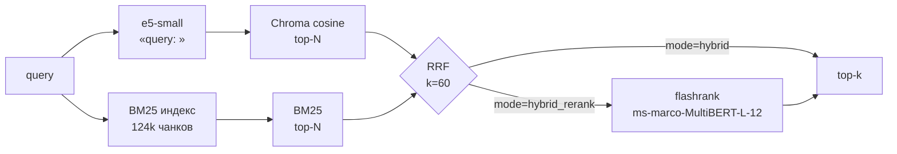

# MCP + RAG for 1C: local semantic search

[](https://github.com/Smaturus/mcp-1c-homework/actions/workflows/ci.yml)


Два столпа проекта, равноправно:

1. **MCP** — свой stdio-сервер (`codesearch`, `metadatasearch`, `search`, `evaluate_retrieval`), без контейнеров;
2. **RAG / retrieval** — локальный контур: chunking → e5-small → Chroma (cosine) → глобальный BM25 → **RRF** → cross-encoder → **eval** качества (Hit@1 / MRR / nDCG / Recall, null-tail, флуктуации).

**протокол/tools для агента**, и **поисковый пайплайн с замерами и ADR**.


### GitHub About (готовая строка)

`MCP + RAG for 1C: stdio tools, local e5/Chroma retrieval, global BM25 + RRF hybrid, optional cross-encoder, file-level eval (nDCG@10 / MRR@10)`

## Быстрый старт

```powershell
py -3.12 -m venv .venv
.\.venv\Scripts\Activate.ps1
pip install -e ".[dev]"

# 1) индекс (нужна локальная выгрузка 1С, пути в README ниже)
python -m mcp_1c_homework.indexer --reset

# 2) лексический индекс для RRF
python scripts\build_bm25.py

# 3) проверка качества
python scripts\make_goldset.py
python scripts\eval_pipeline.py
python scripts\bench.py
```

## Возможности MVP

| Tool | Назначение |
|------|------------|
| `codesearch(query, limit=5)` | семантический поиск по `.bsl` |
| `metadatasearch(query, limit=20)` | поиск по отчёту конфигурации (`.txt`) |
| `evaluate_retrieval(query, …)` | **изюминка:** Hit@k / Recall@k / MRR / **NDCG@10** / null-tail для одного запроса (напр. `НДС`) |
| `search(query, top_k, mode, collection)` | единый пайплайн: `vector` / `hybrid` (RRF) / `hybrid_rerank` / `pearson` |

Стек: **MCP Python SDK 2.x (`MCPServer`)** + **Chroma** + **`intfloat/multilingual-e5-small`**.

### Воспроизводимость baseline

| Параметр | Значение |
|----------|----------|
| Embedding | `intfloat/multilingual-e5-small` (env `MCP_1C_EMBEDDING_MODEL`) |
| HNSW space | cosine (`store.py`) |
| Hybrid (default off) | `MCP_1C_HYBRID=1` → веса `ALPHA` / `BM25_WEIGHT` / `PEARSON_WEIGHT` |
| Git commit индексатора | [`a1f42eb`](https://github.com/Smaturus/mcp-1c-homework/commit/a1f42eb) |

### Метод работы (учебная дисциплина)

Критика «уберите Pearson / сделайте RRF / смените модель» **учтена и проверена данными**: Pearson ушёл в baseline, RRF-гибрид стал основным пайплайном, reranker добавлен вторым этапом, но по замерам проигрывает — оставлен опцией. Смена e5-small сознательно не делалась (требование воспроизводимости MVP). Порядок работы: индексация → baseline → гибрид → rerank → замеры. Решения — в **Decision Log** ниже.

### Метод → где реализовано (библиотека vs наш код)

| Метод | Базово (библиотека) | Наш Python |
|-------|---------------------|------------|
| **Cosine / HNSW** | **Chroma** (`hnsw:space: "cosine"`, `collection.query`) | настройка в `store.py` + `1 - distance` в `search_modes.py` / `eval_retrieval.py` |
| **Эмбеддинги e5** | **sentence-transformers** (`encode`) | обёртка `embeddings.py` (`query:` / `passage:`) |
| **BM25 (глобальный)** | — | `bm25.py`: инвертированный индекс по 124k чанкам, `scripts/build_bm25.py` |
| **RRF** | — | `rrf.py` (`score = Σ 1/(k+rank)`) |
| **Cross-encoder rerank** | **flashrank** (ONNX, `ms-marco-MultiBERT-L-12`) | `rerank.py` (ленивая загрузка, пассаж = путь + код) |
| **Pearson** | — | `metrics.py` (только baseline в eval) |
| **Hybrid rerank (веса)** | — | `hybrid.py` + веса в `config.py` (режим `pearson`) |
| **codesearch / metadatasearch** | Chroma даёт кандидатов | `search.py` + `server.py` |
| **Единый `search` (vector/hybrid/rerank)** | Chroma + BM25 | `search_modes.py` + `server.py` |
| **evaluate_retrieval** | — | `eval_retrieval.py` + `server.py` |
| **Eval пайплайна (4 конфигурации)** | — | `eval_metrics.py` + `scripts/eval_pipeline.py` |
| **Пакетный eval / МНА** | — | `scripts/eval_retrieval_fluctuations.py` |
| **Индексация / chunking** | Chroma `.add` | `indexer.py`, `chunking.py` |

**Итог:** cosine как метрика ANN — в Chroma (формулу не писали). BM25, Pearson, hybrid, eval, MCP tools — наши модули.

## Требования

- Windows, Python **3.11–3.12 предпочтительно** (3.14 может не иметь колёс для `torch` / `chromadb`)
- Локальные источники (пути задаются env или по умолчанию):
  - выгрузка конфигурации (дерево с `.bsl`)
  - отчёт по конфигурации (`.txt`)
- ~2+ ГБ свободно под модель и индекс; для полной индексации лучше ≥6–8 ГБ свободной RAM

## Установка

```powershell
cd <корень-репозитория>
py -3.12 -m venv .venv
# если 3.12 нет: py -3.11 -m venv .venv
.\.venv\Scripts\Activate.ps1
python -m pip install -U pip
pip install -e .
```

Первый запуск скачает модель `intfloat/multilingual-e5-small` в кэш HuggingFace.

## Индексация

Укажите свои каталоги (пример):

```powershell
$env:MCP_1C_STUDY_ROOT="D:\Study"
$env:MCP_1C_STUDY_REPORT_ROOT="D:\Study_Report"
```

Полная пересборка:

```powershell
.\.venv\Scripts\Activate.ps1
python -m mcp_1c_homework.indexer --reset
```

Smoke-тест:

```powershell
python -m mcp_1c_homework.indexer --target code --reset --limit 30 --max-chunks 200
python -m mcp_1c_homework.indexer --target metadata --reset --max-chunks 200
```

Индекс: `data/chroma/` (в `.gitignore`).

Другие переменные: `MCP_1C_CHROMA_DIR`, `MCP_1C_EMBED_BATCH_SIZE`.

## Регистрация в Cursor

В `mcp.json` добавить сервер (пути подставьте свои):

```json
"mcp-1c-homework": {
  "command": "D:\\path\\to\\repo\\.venv\\Scripts\\python.exe",
  "args": ["-m", "mcp_1c_homework"]
}
```

Перезапустить MCP / Cursor. Должны появиться tools `codesearch`, `metadatasearch`, `evaluate_retrieval`.

Пример: `evaluate_retrieval(query="НДС")` — метрики качества по одному запросу.

## Проверка без Cursor

```powershell
.\.venv\Scripts\Activate.ps1
python -c "from mcp_1c_homework.search import codesearch, metadatasearch; print(codesearch('Провести', 3)); print(metadatasearch('Справочник', 3))"
```

## Гибрид cosine + BM25 + Pearson (учебный rerank)

По умолчанию поиск — **только cosine** (Chroma / HNSW).  
**После полной индексации — обязательный этап:** включить hybrid и прогнать eval.

Rerank кандидатов Chroma:

\[
s = w_c\cdot\mathrm{cosine_{n}} + w_b\cdot\mathrm{BM25_{n}} + w_p\cdot\mathrm{Pearson_{n}}
\]

(веса нормализуются к сумме 1). Pearson = cosine после центрирования векторов e5 — **третий сигнал**, не замена пространства HNSW.

```powershell
$env:MCP_1C_HYBRID="1"
$env:MCP_1C_HYBRID_ALPHA="0.5"              # вес cosine
$env:MCP_1C_HYBRID_BM25_WEIGHT="0.3"        # точные термины / пути 1С
$env:MCP_1C_HYBRID_PEARSON_WEIGHT="0.2"     # 0 = выключить Пирсон
$env:MCP_1C_HYBRID_CANDIDATE_MULT="4"
```

Файлы: `bm25.py`, `metrics.py` (Pearson), `hybrid.py`; вызов в `search.py`.  
`evaluate_retrieval` всегда показывает cosine и pearson по top hits.

## Оценка качества поиска (флуктуации / МНА) — обязательно после индексации

- Скрипт: `scripts/eval_retrieval_fluctuations.py`
- Эталон: `data/eval/golden_queries.example.json` (расширить своими запросами)
- В golden желательны **три типа** запросов: точное имя / смысловой / гибрид-ловушка (см. `progress.md`)
- В отчёте: Hit@k, Recall@k, MRR, **NDCG@10**; **null-хвост** — отдельная секция с примерами

```powershell
python scripts\eval_retrieval_fluctuations.py --golden data\eval\golden_queries.example.json --null-pairs 300
```

### Decision Log (заполняется после замеров)

| Решение | Альтернатива | Почему выбрали | Данные |
|---------|--------------|----------------|--------|
| **RRF-гибрид — основной пайплайн**, Pearson — только baseline | Оставить взвешенный `cos+BM25+Pearson` | nDCG@10 0.272 → 0.378, MRR@10 0.170 → 0.193 при латентности ~60–100 мс; RRF не требует калибровки скоров | `data/eval/report_pipeline.md` |
| **`w_pearson` не используется** в основном пайплайне | Регулировать вес Пирсона | Pearson после центрирования e5 почти дублирует cosine и не даёт прироста; в eval остаётся как baseline | `data/eval/report_pipeline.md` |
| **Reranker оставлен опцией**, не дефолтом | Сделать `hybrid_rerank` дефолтом | Cross-encoder ухудшает nDCG@10 (0.378 → 0.134) и на порядок медленнее; домен BSL не совпадает с веб-обучением ms-marco | `data/eval/report_pipeline.md` |
| **Токенизация BM25 под 1С** (коды с дефисом, кириллица, регистр) | Стандартный alphanumeric | Точные имена `ПередЗаписью`, `НФ-001` — сильный сигнал гибрида; тип `exact`: nDCG 0.040 → 0.460 | `tests/test_bm25.py`, `data/eval/report_pipeline.md` |
| **File-level метрики** в eval | Релевантность по конкретным чанкам | Чанков на файл — сотни: чанковые эталоны давали ложно-нулевые метрики, файловые устойчивы и воспроизводимы | `src/mcp_1c_homework/eval_metrics.py` |
| **e5-small остаётся** | Более крупная модель | Требование плана и воспроизводимость baseline; выигрыш гибрида достигнут без смены модели | — |

## Retrieval pipeline: vector → RRF → rerank

Единый пайплайн доступен в MCP-туле `search(query, top_k, mode)` и в коде
(`src/mcp_1c_homework/search_modes.py`):



| Режим | Что делает | Латентность |
|---|---|---|
| `vector` | только cosine (baseline) | ~50–90 мс |
| `pearson` | взвешенный `cos + BM25 + Pearson` (прежний MVP) | ~90–155 мс |
| `hybrid` | cosine + глобальный BM25 через **RRF** | ~60–100 мс |
| `hybrid_rerank` | RRF + cross-encoder вторым этапом | ~1,1–6 с |

Ключевые свойства реализации:

- **RRF по рангам**, а не по сырым скорам: `score(d) = Σ 1/(k_rrf + rank_i(d))`, `k_rrf = 60`;
- **глобальный BM25** по всем 124 253 чанкам (инвертированный индекс, 51 МБ,
  сборка ~9 с): `python scripts/build_bm25.py` → `data/bm25/`;
- токенизация сохраняет коды 1С (`НФ-001`, `НДС-18`) и аббревиатуры;
- префиксы e5 (`query: ` / `passage: `) не теряются: запрос кодируется
  `embed_query`, документы — индексатором;
- reranker **не заменяет** e5-small, а переупорядочивает 20 кандидатов RRF;
- конфиг — env-переменные в `config.py` (модель, `top_k`, `k_rrf`, `max_length`).

### Как включить

```powershell
# 1) собрать глобальный BM25-индекс (один раз, после индексации Chroma)
python scripts\build_bm25.py

# 2) вызвать через MCP или из кода
python -c "from mcp_1c_homework.search_modes import search; print(search('НДС с аванса', top_k=3, mode='hybrid'))"
```

## Evaluation: сравнение конфигураций

Скрипт `scripts/eval_pipeline.py`, gold-set `data/eval/gold_set.jsonl`
(30 запросов: 10 курируемых + 20 из реальных модулей; три типа —
`exact` / `semantic` / `trap`). Релевантность — **на уровне файла-источника**,
метрики: Hit@1, MRR@10, nDCG@10, Recall@10 (см. `eval_metrics.py`).

```powershell
python scripts\make_goldset.py
python scripts\eval_pipeline.py                 # один прогон
python scripts\build_bm25.py                    # (если ещё не собран)
# воспроизводимость: 3 отдельных прогона + агрегатор mean ± std
python scripts\eval_stability.py
```

Замеры (30 запросов, k=10; **mean ± std по 3 независимым прогонам** для трёх
конфигураций; reranker измерен однократно из-за стоимости):

| Конфигурация | Hit@1 | MRR@10 | nDCG@10 | Recall@10 | мс/запрос |
|---|---|---|---|---|---|
| `vector` | 0.044 ± 0.016 | 0.123 ± 0.018 | 0.223 ± 0.012 | 0.243 ± 0.027 | ~50–90 |
| `pearson` | 0.111 ± 0.016 | 0.170 ± 0.018 | 0.272 ± 0.022 | 0.239 ± 0.021 | ~90–155 |
| **`hybrid` (RRF)** | **0.100 ± 0.000** | **0.193 ± 0.003** | **0.378 ± 0.003** | **0.311 ± 0.016** | **~60–100** |
| `hybrid_rerank` | 0.000 | 0.053 | 0.134 | 0.167 | ~1100–6000 |

**Честный вывод:**

1. **RRF-гибрид выигрывает** у чистого cosine по nDCG@10 (+69 %), MRR@10 (+57 %)
   и Recall@10 (+28 %), практически без роста латентности. Разброс гибрида
   минимальный (±0.003 nDCG), то есть вывод устойчив к пересборке HNSW.
2. **Pearson даёт прирост только над чистым cosine**, но проигрывает RRF
   (nDCG 0.272 против 0.378) и медленнее, поэтому оставлен baseline-режимом.
3. **Cross-encoder reranker ухудшает результат** на этом корпусе (nDCG@10
   0.378 → 0.134) и на порядок медленнее. Гипотеза: модель
   `ms-marco-MultiBERT-L-12` обучена на веб-пассажах, а не на BSL-коде;
   код — длинные повторяющиеся фрагменты, где токенизатор cross-encoder'а
   видит мало различающего сигнала. **Мы не «крутим» пайплайн под результат**:
   режим оставлен как опция, по умолчанию (измеренно) выбрана `hybrid`.
4. Ограничение: gold-set частично синтетический (авто-часть выведена из
   реальных файлов), поэтому абсолютные значения скромные; сравнение
   конфигураций от этого не страдает — все они меряются на одном наборе.

## Тики прогресса длинной индексации

Луп: `scripts/index_tick_loop.py`; управление: `python scripts/index_tick_ctl.py status|stop`.

## Ограничения / вне MVP

- Нет отдельного help-поиска и graph/Neo4j.
- Публично не распространяются выгрузки 1С и векторный индекс чужой базы.
- **Reranker** реализован, но по замерам ухудшает качество на BSL — включён опционально (ADR 0002).
- **HNSW не персистится** при `hnsw:sync_threshold=1000000` (защита от chroma#7090): старт процесса пересобирает индекс из sqlite (~60–70 с на 124 тыс. чанков).
- Gold-set частично синтетический: абсолютные метрики скромные, сравнение конфигураций корректно.
- Fine-tune и смена embedding-модели — следующий контур.

## Документация

| Документ | Содержание |
|---|---|
| [docs/ARCHITECTURE.md](docs/ARCHITECTURE.md) | компоненты, потоки данных, хранение, риски, точки расширения |
| [docs/adr/0001-rrf-over-pearson.md](docs/adr/0001-rrf-over-pearson.md) | почему RRF вместо взвешенного Pearson |
| [docs/adr/0002-reranker-optional.md](docs/adr/0002-reranker-optional.md) | почему cross-encoder не стал дефолтом |
| [docs/adr/0003-file-level-evaluation.md](docs/adr/0003-file-level-evaluation.md) | почему метрики считаются по файлам |
| [data/eval/report_pipeline.md](data/eval/report_pipeline.md) | сравнение 4 конфигураций на 30 запросах |
| [data/eval/bench.md](data/eval/bench.md) | латентность p50/p95, размеры индексов |
| [docs/presentation/MCP_1C_Homework.pptx](docs/presentation/MCP_1C_Homework.pptx) | презентация проекта для защиты (12 слайдов) |
| [CHANGELOG.md](CHANGELOG.md) | история изменений |

## Разработка и качество

```powershell
pip install -e ".[dev]"

pytest -q                  # 33 unit-теста (без ML-стека: импорты ленивые)
ruff check .               # линтер
mypy                       # проверка типов (20 модулей)
```

Quality gates в CI ([.github/workflows/ci.yml](.github/workflows/ci.yml)): `ruff` + `mypy` + `pytest`
на Python 3.11 и 3.12. Unit-тесты не требуют Chroma/torch — тяжёлые зависимости
импортируются лениво, поэтому CI остаётся быстрым.

## Структура репозитория

```
pyproject.toml, README.md, CHANGELOG.md, LICENSE
src/mcp_1c_homework/
  server.py         MCP-сервер и tools
  search_modes.py   vector / hybrid (RRF) / hybrid_rerank / pearson
  bm25.py           токенизация + BM25Okapi + глобальный Bm25Index
  rrf.py            Reciprocal Rank Fusion
  rerank.py         flashrank cross-encoder (опция)
  models.py         Candidate (лёгкая модель результата)
  eval_metrics.py   file-level метрики
  indexer.py, chunking.py, embeddings.py, store.py, hybrid.py, metrics.py
scripts/
  build_bm25.py     сборка лексического индекса
  make_goldset.py   генерация gold-set (10 ручных + 20 авто)
  eval_pipeline.py  сравнение конфигураций
  eval_stability.py mean ± std по нескольким прогонам
  bench.py          латентность p50/p95
tests/              unit-тесты (bm25, rrf, rerank, metrics)
docs/               архитектура и ADR
data/               локальные артефакты (в git только gold-set и отчёты)
```

## Roadmap

- [x] MCP stdio tools + локальный индекс (e5 + Chroma)
- [x] Глобальный BM25 и RRF-гибрид
- [x] Cross-encoder reranker как опция + замеры
- [x] File-level eval и Decision Log
- [ ] Reranker, предобученный на коде (или fine-tune на gold-set)
- [ ] Увеличение gold-set до 100 запросов с доверительными интервалами
- [ ] Опциональный режим `rrf` с весами источников и его сравнение

## Лицензия

MIT — см. [LICENSE](LICENSE).

## Контакты

**Sergey Matyukhin** — AI/LLM, Москва.

- GitHub: [@Smaturus](https://github.com/Smaturus)
- Email: [smaturus@gmail.com](mailto:smaturus@gmail.com)

Проект выполнен как учебная и портфолио-работа; выгрузка конфигурации 1С
и личные данные в репозиторий не входят.
