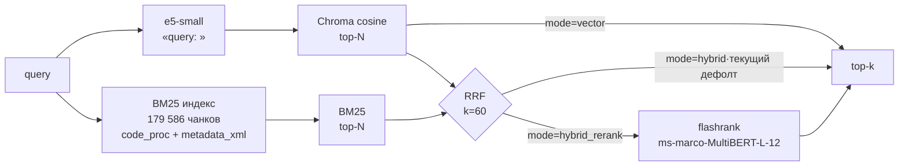

# 1C MCP RAG Search

[](https://github.com/Smaturus/1c-mcp-rag-search/actions/workflows/ci.yml) [](https://github.com/Smaturus/1c-mcp-rag-search/releases/latest) [](#подключение-к-клиенту)

[](https://m8ven.ai/mcp/smaturus-1c-mcp-rag-search-1loj34?s=readme)

Поисковый слой для выгрузки 1С, доступный LLM-агенту через **MCP**: находит нужную бизнес-логику по BSL-коду и по метаданным конфигурации, даже если точное имя неизвестно. Работает локально, без внешних API: данные не покидают машину.

Внутри — гибридный retrieval с двумя независимыми сигналами: семантическим (e5-small + Chroma) и лексическим (собственный BM25), объединёнными через Reciprocal Rank Fusion. Качество измерено на собственном gold-set: `hybrid` — дефолт, потому что на dev-наборе он значимо лучше `vector`, а на независимом hold-out — не хуже.

| Показатель | Значение |
| --- | --- |
| Индекс | **179 586** чанков: 154 560 кода (нарезка по процедурам) + 25 026 метаданных (XML) |
| Лексический индекс | глобальный BM25: 179 586 документов, 236 320 термов, **81 МБ** (`data/bm25_all`, локально) |
| Качество, v2 dev (nDCG@10) | **hybrid 0.442 ± 0.012** против **vector 0.331 ± 0.028**; Δ = −0.112, CI [−0.184; −0.038], p = **0.0037** |
| Качество, v3 hold-out | hybrid 0.217 ± 0.015, vector 0.208 ± 0.020; p = 0.635 — не хуже |
| Латентность (CPU) | **50–105 мс** `vector`, **100–120 мс** `hybrid`, ~2,4 с `hybrid_rerank` |
| Инженерные проверки | **74 unit-теста**, `ruff` — 0, `mypy` — 0 ошибок (22 модуля), гейт сложности, CI 3.11/3.12 |


## Задача

Выгрузка 1С — тысячи `.bsl`-модулей и XML-метаданные. Разработчику нужно быстро найти, где реализована конкретная логика, а LLM-агенту — надёжный инструмент поиска вместо `grep`. Проект даёт и то и другое: MCP-сервер со стандартными инструментами и воспроизводимый retrieval-пайплайн с метриками, ADR и публично зафиксированными ограничениями.

## Как это работает



Cosine по e5-small и глобальный BM25 по 179 586 чанкам двух коллекций (`code_proc` + `metadata_xml`) объединяются по рангам через RRF. Cross-encoder подключается опционально вторым этапом. Устройство — в [docs/ARCHITECTURE.md](docs/ARCHITECTURE.md).

## Быстрый старт

Нужны Python 3.11–3.12, дерево `.bsl` и XML-выгрузка конфигурации, 2+ ГБ на модель и индекс (6–8 ГБ RAM для полной индексации).

```powershell
git clone https://github.com/Smaturus/1c-mcp-rag-search.git
cd 1c-mcp-rag-search
py -3.12 -m venv .venv
.\.venv\Scripts\Activate.ps1
pip install -e ".[dev]"

$env:MCP_1C_STUDY_ROOT="D:\Study"                 # дерево .bsl
$env:MCP_1C_METADATA_XML_ROOT="D:\Study_XML"     # XML-выгрузка
$env:MCP_1C_CHROMA_DIR="data\chroma_xml"          # код + метаданные
$env:MCP_1C_BM25_DIR="data\bm25_all"              # глобальный BM25

python scripts\build_procedure_index.py --no-lock           # code_proc
python scripts\parse_config_xml.py --root $env:MCP_1C_METADATA_XML_ROOT
python scripts\build_metadata_index.py --reset              # metadata_xml
python scripts\build_bm25.py --chroma-dir data\chroma_xml --out data\bm25_all
python scripts\eval_pipeline.py --golden data\eval\gold_set_v2.jsonl --out-dir data\eval\code_proc
```

Первый запуск скачивает `intfloat/multilingual-e5-small`. Пути `D:\Study` — примеры. Legacy-индексатор (символьные окна + текстовый отчёт) остаётся для ablation: `python -m mcp_1c_rag.indexer --reset` и `python scripts\build_bm25.py --chroma-dir data\chroma --out data\bm25`. Смоук — `--files 300 --collection code_proc_smoke --reset`.

## MCP-инструменты

| Tool | Назначение |
| --- | --- |
| `search(query, top_k, mode, collection)` | единый пайплайн: `lexical` / `vector` / `hybrid` (дефолт) / `hybrid_rerank` / `pearson` |
| `search_1c_metadata(query, limit=10)` | grep-подобный лексический поиск: имена, обработчики, движения, проводки, «кто пишет в регистр» |
| `search_knowledge_base(query, limit=10)` | векторный поиск: «как сделать», «почему не работает», инструкции |
| `search_hybrid(query, limit=10)` | гибрид (RRF): смешанные формулировки, требования, ТЗ |
| `route_query(query)` | маршрут, инструмент, причина и уверенность |
| `index_stats()` | какой индекс обслуживается: каталог, коллекции, размеры, дефолтный режим |
| `codesearch(query, limit=5)` | семантический поиск по `.bsl` (исторический baseline) |
| `metadatasearch(query, limit=20)` | поиск по метаданным (исторический) |
| `evaluate_retrieval(query, k, …)` | Hit@k, Recall@k, MRR, nDCG по одному запросу |


Стек: MCP Python SDK 2.x + Chroma + `intfloat/multilingual-e5-small` + собственный BM25 + flashrank (опция).

## Маршрутизация

Правила выбора инструмента — код с тестами ([`router.py`](src/mcp_1c_rag/router.py), [`tests/test_router.py`](tests/test_router.py)), а не текст промпта.

| Признак в запросе | Маршрут |
| --- | --- |
| CamelCase-имена, коды (`НФ-001`), «проводки», «движения», «кто пишет в регистр», «на основании» | `lexical` |
| «как сделать», «почему не работает», «инструкция», «опыт», «лучшие практики» | `vector` |
| требования, ТЗ, регламент, Confluence; смесь точного и смыслового | `hybrid` |
| признаков нет | `hybrid` |


Регрессия — 68/68, но кейсы использовались при настройке. На независимом hold-out v3 роутер даёт 58/100 (43/76 на отвечаемых); основная ошибка — `lexical→hybrid`. Маршрутизация не ухудшает качество, но доказанного прироста нет. Контракт — [ADR 0006](docs/adr/0006-query-routing.md), детали — [docs/EVALUATION.md](docs/EVALUATION.md#маршрутизация).

## Retrieval pipeline

Единая точка входа — `search(query, top_k, mode)` в [`search_modes.py`](src/mcp_1c_rag/search_modes.py).

| Режим | Что делает | Латентность |
| --- | --- | --- |
| `vector` | только cosine (baseline) | ~50–105 мс |
| `pearson` | взвешенный `cos + BM25 + Pearson` (исторический baseline) | ~85–160 мс |
| `hybrid` | cosine + глобальный BM25 через RRF (дефолт) | ~100–120 мс |
| `hybrid_rerank` | RRF + cross-encoder вторым этапом | ~2,4 с |


- **RRF по рангам**: `score(d) = Σ 1/(k_rrf + rank_i(d))`, `k_rrf = 60`.

- **Глобальный BM25** по 179 586 чанкам: собственный инвертированный индекс.

- **Токенизация под 1С**: кириллица, цифры, дефисные коды, CamelCase/snake_case с сохранением исходного токена (ADR 0010).

- **Префиксы e5** (`query: ` / `passage: `) сохраняются.

- **Reranker** переупорядочивает 20 кандидатов RRF, а не заменяет e5.

- Параметры — переменные окружения в [`config.py`](src/mcp_1c_rag/config.py).

```powershell
python -c "from mcp_1c_rag.search_modes import search; print(search('НДС с аванса', top_k=3, mode='hybrid'))"
```

## Chunking по процедурам

`.bsl` режется по границам `Процедура`/`Функция` … `КонецПроцедуры`/`КонецФункции` ([`chunking_procedures.py`](src/mcp_1c_rag/chunking_procedures.py), ADR 0007). Чанк получает префикс `// file: <path> · proc: <name>`; код вне процедур идёт отдельным чанком; длинная процедура делится на части с перекрытием 150 символов. Параметры: `max_chars=1000`, `overlap=150`.

Смоук на 800 файлах: покрытие кода **99,6 %**, чанков сверх 512 токенов **0,3 %**, токены p50/p99/max — 179/472/554. Отчёт — [`data/eval/procedure_chunking_smoke.md`](data/eval/procedure_chunking_smoke.md).

## Оценка качества

Релевантность — на уровне файла-источника, повторные чанки схлопываются до расчёта метрик (ADR 0003–0004). v2 — dev-набор, v3 — независимый hold-out.

**v2, 70 запросов, 4 прогона:**

| Конфигурация | Hit@1 | MRR@10 | nDCG@10 | Recall@10 |
| --- | --- | --- | --- | --- |
| `lexical` | 0.271 | 0.355 | 0.426 | 0.571 |
| `vector` | 0.164 ± 0.018 | 0.266 ± 0.026 | 0.331 ± 0.028 | 0.511 ± 0.044 |
| `pearson` | 0.207 ± 0.038 | 0.313 ± 0.039 | 0.383 ± 0.040 | 0.562 ± 0.053 |
| **`hybrid`** | **0.221 ± 0.008** | **0.368 ± 0.010** | **0.442 ± 0.012** | **0.652 ± 0.024** |


Парный тест (n = 70): Δ nDCG@10 (`vector` − `hybrid`) = **−0.112**, CI **[−0.184; −0.038]**, p = **0.0037**, побед/ничьих/поражений — 22/22/26.

**v3 hold-out, 71 code-запрос, 3 прогона:** `hybrid` 0.217 ± 0.015, `vector` 0.208 ± 0.020, `pearson` 0.229 ± 0.019, `lexical` 0.218; Δ = −0.0097, p = 0.635 — не значимо. **Метаданные:** XML-выгрузка (25 026 чанков) даёт BM25 Hit@3 **99,7 %** против 93,0 % у текстового отчёта.

Методика, латентность и разбивка по типам — [docs/EVALUATION.md](docs/EVALUATION.md). История чисел и отклонённые гипотезы — [docs/HISTORY.md](docs/HISTORY.md).

## Воспроизводимость

| Параметр | Значение |
| --- | --- |
| Корпус | `code_proc` 154 560 + `metadata_xml` 25 026 в `data/chroma_xml` (локально) |
| Embedding | `intfloat/multilingual-e5-small`, 384 измерения, 512 токенов, префиксы `query:`/`passage:` |
| HNSW | cosine (`store.py`) |
| BM25 | собственный индекс (`bm25.py`), `k1=1.5`, `b=0.75` |
| RRF | `k_rrf = 60` (`MCP_1C_RRF_K`) |
| Дефолтный режим | `hybrid` (`MCP_1C_SEARCH_MODE`) |


## Подключение к клиенту

В `mcp.json` (Cursor) или `mcp.servers` (ZCode):

```json
"1c-mcp-rag-search": {
  "command": "D:\\path\\to\\repo\\.venv\\Scripts\\python.exe",
  "args": ["-m", "mcp_1c_rag"]
}
```

После перезапуска клиента появятся все **9 tools**. Проверка без клиента:

```powershell
python -c "from mcp_1c_rag.search import codesearch, metadatasearch; print(codesearch('Провести', 3)); print(metadatasearch('Справочник', 3))"
```

## Разработка и качество

```powershell
pytest -q        # 74 unit-теста (ML-стек не требуется: импорты ленивые)
ruff check .     # линтер
mypy             # типы (22 модуля)
python scripts\check_complexity.py   # гейт сложности (radon)
pytest -q --cov=src/mcp_1c_rag       # покрытие
```

CI ([.github/workflows/ci.yml](.github/workflows/ci.yml)): `ruff` + `mypy` + гейт цикломатической сложности + `pytest` с покрытием на Python 3.11 и 3.12; тяжёлые зависимости импортируются лениво.

| Гейт | Порог | Сейчас |
| --- | --- | --- |
| `ruff` / `mypy` | без замечаний | **0 / 0** |
| Сложность (`radon`) | средняя ≤ 6, блоки > 20 только из baseline, MI ≥ 20 | **4.37 (A)**, 143 блока |
| Baseline сложных функций | не расти, только сокращать | 2 записи: `evaluate_retrieval` (33), `index_metadata` (30) |
| Покрытие | floor 25 %, цель 60 % | **≥ 25 %** |
| Unit-тесты | не уменьшать | **74** |


## Структура

```
src/mcp_1c_rag/      22 модуля: server, search_modes, bm25, rrf, rerank,
                     router, chunking*, embeddings, store, metrics, index_guard
scripts/             сборка индексов, eval, диагностика
tests/               74 unit-теста
docs/                ARCHITECTURE.md, EVALUATION.md, HISTORY.md, adr/
data/eval/           gold-set и отчёты (индекс — data/eval/README.md)
```

## Ограничения

- HNSW не персистится при `hnsw:sync_threshold=1000000` (защита от chroma#7090): старт процесса пересобирает индекс из sqlite (~60–70 с).

- Один писатель; параллельная индексация не поддерживается.

- Инкрементального обновления нет: после изменения выгрузки индекс пересобирается целиком (прерванную сборку можно возобновить).

- Gold-set частично синтетический, e5-small не обучена на BSL: абсолютные метрики скромные, корректно сравнивать конфигурации на одном наборе.

- Выгрузки 1С и векторные индексы в репозиторий не попадают.

- Клетка 2×2 «старая выгрузка × процедурная нарезка» не измерима, остальные сняты до ADR 0010; повторный замер — в roadmap.

## Roadmap

- [ ] Код-ориентированная embedding-модель и новый baseline

- [x] RRF с весами источников, preprocessing и глубина каналов — проверено, значимого прироста на v2 нет ([docs/HISTORY.md](docs/HISTORY.md))

- [ ] Новый независимый hold-out для маршрутизации (≥ 20 фраз)

- [ ] Повторный замер 2×2 исправленным токенизатором BM25

- [ ] English README (`README.en.md`)

Завершённые этапы и отклонённые гипотезы — [docs/HISTORY.md](docs/HISTORY.md).

## Документация

| Документ | Содержание |
| --- | --- |
| [docs/ARCHITECTURE.md](docs/ARCHITECTURE.md) | компоненты, потоки данных, хранение, риски |
| [docs/EVALUATION.md](docs/EVALUATION.md) | методика, наборы, метрики, воспроизведение |
| [docs/HISTORY.md](docs/HISTORY.md) | таймлайн и отклонённые гипотезы |
| [docs/adr/](docs/adr/) | архитектурные решения со статусами |
| [data/eval/README.md](data/eval/README.md) | индекс отчётов: актуально / историческое / superseded |
| [CHANGELOG.md](CHANGELOG.md) | история релизов |
| [CONTRIBUTING.md](CONTRIBUTING.md) · [SECURITY.md](SECURITY.md) | как внести изменение и сообщить об уязвимости |


## Данные и безопасность

В репозитории нет выгрузок 1С, готовых индексов и персональных данных. Примеры и скриншоты используют стандартные имена объектов конфигурации; абсолютные пути в отчётах заменены на относительные. О проблеме — [SECURITY.md](SECURITY.md).

## Лицензия

MIT — см. [LICENSE](LICENSE).

## Контакты

Автор — **Sergey Matyukhin**.

- GitHub: [@Smaturus](https://github.com/Smaturus)

- Email: [smaturus@gmail.com](mailto:smaturus@gmail.com)


