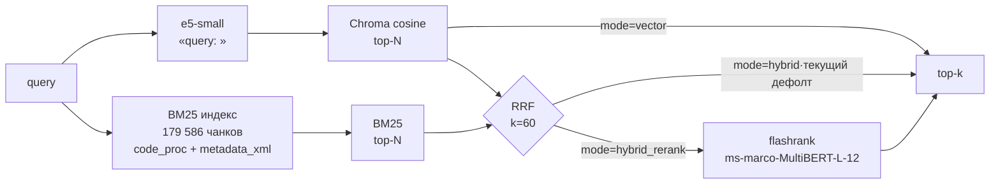

# 1C MCP RAG Search
[](https://m8ven.ai/mcp/smaturus/1c-mcp-rag-search)
[](https://github.com/Smaturus/1c-mcp-rag-search/actions/workflows/ci.yml)
[](https://github.com/Smaturus/1c-mcp-rag-search/releases/latest)


Поисковый слой для выгрузки 1С, доступный LLM-агенту через **MCP**: находит нужную
бизнес-логику по BSL-коду и по метаданным конфигурации, даже если точное имя
неизвестно. Всё работает локально без внешних API, данные не покидают машину.

Внутри — retrieval с двумя независимыми сигналами (semantic + lexical), измеренный
на собственном gold-set. В ходе проверки найден дефект BM25-токенизатора: после
его исправления `hybrid` снова значимо впереди на dev-наборе, а прежний «сдвиг
лидера» отклонён (ADR 0010; ADR 0009 — rejected).

| Показатель | Значение |
|---|---|
| Индекс | **179 586** чанков: 154 560 чанков кода (нарезка по процедурам) + 25 026 метаданных (XML) |
| Лексический индекс | глобальный BM25: **179 586** документов, 236 320 термов, **81 МБ** на диске (`data/bm25_all`; локальный артефакт, в git не входит) |
| Качество (nDCG@10) | v2, 4 прогона: **hybrid 0.442 ± 0.012** против **vector 0.331 ± 0.028**; Δ = −0.112, CI [−0.184; −0.038], p = **0.0037**. v3 hold-out, 3 прогона: hybrid 0.217 ± 0.015, vector 0.208 ± 0.020 (p = 0.635) |
| Латентность | **35–100 мс** (`vector`), **50–120 мс** (`hybrid`) на CPU без GPU; `hybrid_rerank` — ~2,4 с/запрос (опция) |
| Инженерные проверки | **74 unit-теста**, `ruff` — 0 замечаний, `mypy` — 0 ошибок (22 модуля), гейт сложности, CI на Python 3.11/3.12 |

## Задача

Выгрузка 1С — это тысячи `.bsl`-модулей и XML-метаданные конфигурации. Разработчику
нужно быстро найти, где реализована конкретная логика, а LLM-агенту — надёжный
инструмент поиска вместо `grep`.

Проект решает две задачи:

1. **протокол** — MCP-сервер со стандартными инструментами для любого MCP-клиента;
2. **качество** — воспроизводимый retrieval-пайплайн с метриками и обоснованными
   архитектурными решениями, а не «поиск, который просто работает».

## Как это работает



Два независимых сигнала — семантический (cosine по e5-small) и лексический
(глобальный BM25 по 179 586 чанкам двух коллекций: `code_proc` + `metadata_xml`) —
объединяются через **Reciprocal Rank Fusion** по рангам. Текущий дефолт — `hybrid`;
после исправления BM25-токенизатора он значимо лучше `vector` на dev-наборе
(0.442 против 0.331, p = 0.0037) и не хуже на v3 (0.217 против 0.208, p = 0.635),
поэтому дефолт подтверждён ([ADR 0010](docs/adr/0010-camelcase-bm25-tokenizer.md);
[ADR 0009](docs/adr/0009-corpus-change-metrics-shift.md) — rejected).
Cross-encoder подключается опционально как второй этап.

Подробнее — [docs/ARCHITECTURE.md](docs/ARCHITECTURE.md).

## Быстрый старт

```powershell
git clone https://github.com/Smaturus/1c-mcp-rag-search.git
cd 1c-mcp-rag-search
py -3.12 -m venv .venv
.\.venv\Scripts\Activate.ps1
pip install -e ".[dev]"

# пути к локальным источникам и индексам (подробнее — в разделе «Индексация»)
$env:MCP_1C_STUDY_ROOT="D:\Study"                 # дерево .bsl
$env:MCP_1C_METADATA_XML_ROOT="D:\Study_XML"     # XML-выгрузка конфигурации
$env:MCP_1C_CHROMA_DIR="data\chroma_xml"          # код + метаданные
$env:MCP_1C_BM25_DIR="data\bm25_all"              # глобальный BM25

# 1) код: нарезка по процедурам → коллекция code_proc
python scripts\build_procedure_index.py --no-lock

# 2) метаданные: XML-выгрузка → коллекция metadata_xml (та же база)
python scripts\parse_config_xml.py --root $env:MCP_1C_METADATA_XML_ROOT
python scripts\build_metadata_index.py --reset

# 3) глобальный BM25 по обеим коллекциям
python scripts\build_bm25.py --chroma-dir data\chroma_xml --out data\bm25_all

# 4) проверка качества
python scripts\eval_pipeline.py --golden data\eval\gold_set_v2.jsonl --out-dir data\eval\code_proc
```

Первый запуск скачивает модель `intfloat/multilingual-e5-small` в кэш HuggingFace.

## MCP-инструменты

| Tool | Назначение |
|---|---|
| `search(query, top_k, mode, collection)` | единый пайплайн: `lexical` / `vector` / `hybrid` (RRF, текущий дефолт) / `hybrid_rerank` / `pearson` |
| `search_1c_metadata(query, limit=10)` | **grep-подобный** лексический поиск (BM25): точные имена, обработчики, «движения», «проводки», «кто пишет в регистр», «на основании» |
| `search_knowledge_base(query, limit=10)` | векторный поиск (e5 cosine): «как сделать», «почему не работает», инструкции, опыт |
| `search_hybrid(query, limit=10)` | гибрид (RRF): смешанные формулировки, требования/ТЗ/Confluence |
| `route_query(query)` | объясняет выбор: маршрут, инструмент, причина, уверенность |
| `index_stats()` | показывает обслуживаемый индекс: каталог Chroma, коллекции, размеры, дефолтный режим — проверка «тот ли индекс открыт» |
| `codesearch(query, limit=5)` | семантический поиск по `.bsl` (исторический cosine-baseline) |
| `metadatasearch(query, limit=20)` | поиск по метаданным конфигурации (исторический) |
| `evaluate_retrieval(query, k, …)` | метрики по одному запросу: Hit@k, Recall@k, MRR, nDCG, null-tail |

Итого **9 инструментов**. Стек: **MCP Python SDK 2.x (`MCPServer`)** + **Chroma**
+ **`intfloat/multilingual-e5-small`** + собственный BM25/инвертированный индекс
+ **flashrank** (опция).

### Маршрутизация запросов

Правила выбора инструмента — не текст промпта, а код с тестами:
[`router.py`](src/mcp_1c_rag/router.py) + [`tests/test_router.py`](tests/test_router.py).
При сомнении выбирается `search_hybrid` (безопасный дефолт).

| Признак в запросе | Маршрут | Почему |
|---|---|---|
| CamelCase-имена (`РеализацияТоваровУслуг`), коды (`НФ-001`), «проводки», «движения», «кто пишет в регистр», «на основании», «связанные документы» | **lexical** | точное совпадение лексики надёжнее эмбеддинга; ранжирование вместо «сырого grep» |
| «как сделать», «почему не работает», «инструкция», «опыт», «лучшие практики» | **vector** | смысл без точных терминов |
| требования, ТЗ, регламент, Confluence; смесь точного и смыслового | **hybrid** | нужны оба сигнала |
| признаков нет | **hybrid** | правило «сомневаешься — hybrid» |

Измерения (`scripts/eval_router.py`, отчёты [`data/eval/router_report.md`](data/eval/router_report.md)
и [`data/eval/part3_blind_report.md`](data/eval/part3_blind_report.md)):

| Метрика | Значение |
|---|---|
| Регрессионный набор (24 базовых + 15 заказчика + 17 Part-2 + 15 N-кейсов, дубликаты схлопнуты) | **100 %** (68/68) |
| **Blind Part-3 (20 кейсов) — до правок** | **75 %** (15/20) → гейт 80 % не пройден |
| Blind Part-3 после правок | 20/20, но набор стал dev (честно: нужен новый hold-out) |
| End-to-end nDCG@10 routed vs fixed hybrid (прежний корпус, историческое) | 0.216 vs 0.216 |
| Recall@10 routed vs fixed hybrid (прежний корпус, историческое) | 0.357 vs 0.371 |

На новом корпусе политики маршрутизации проверены отдельно (один прогон): политика C
(`lexical→lexical`, `hybrid→vector`) даёт nDCG@10 **0.329** против **0.315** у fixed
`vector` — лучше, но в пределах шума (±0,02). Поэтому маршруты не меняются до
независимой выборки; смена лидера отклонена после фикса BM25 (ADR 0010),
маршрутизация остаётся ADR 0006.

Вывод зафиксирован честно: маршрутизация **не ухудшает** качество, но и не даёт
доказанного прироста. На gold-set v2 большая часть запросов — смысловые с точным
именем и по контракту уходят в `hybrid`, поэтому routed-политика на прежнем корпусе
совпала с fixed `hybrid`. Поэтому дефолт остаётся `hybrid`, а правила — ADR 0006.
Регрессионные кейсы использовались при настройке правил, поэтому 100 % — проверка
контракта, а не оценка обобщения. Единственная независимая проверка (blind Part-3,
хэш зафиксирован) дала 75 % **до** правок — это ниже гейта; после правок нужен
новый hold-out, чтобы заявлять ≥ 80 % обобщения (долг зафиксирован в ADR 0006).

## Retrieval pipeline

Единая точка входа — `search(query, top_k, mode)` в
[src/mcp_1c_rag/search_modes.py](src/mcp_1c_rag/search_modes.py).

| Режим | Что делает | Латентность |
|---|---|---|
| `vector` | только cosine (baseline) | ~35–100 мс |
| `pearson` | взвешенный `cos + BM25 + Pearson` (исторический baseline) | ~65 мс (один прогон) |
| `hybrid` | cosine + глобальный BM25 через **RRF** (текущий дефолт) | ~50–120 мс |
| `hybrid_rerank` | RRF + cross-encoder вторым этапом | ~2,4 с |

Ключевые свойства:

- **RRF по рангам**, а не по сырым скорам: `score(d) = Σ 1/(k_rrf + rank_i(d))`, `k_rrf = 60`;
- **глобальный BM25** по всем **179 586** чанкам двух коллекций (`code_proc` 154 560 +
  `metadata_xml` 25 026): собственный инвертированный индекс, ~57,6 МБ, локальный
  артефакт `data/bm25_all`, в git не входит;
- токенизация под 1С: кириллица, цифры, дефисные коды (`НФ-001`, `НДС-18`);
- префиксы e5 (`query: ` / `passage: `) сохраняются: запрос кодируется `embed_query`,
  документы — индексатором;
- reranker **не заменяет** e5-small, а переупорядочивает 20 кандидатов RRF;
- параметры (модель, `top_k`, `k_rrf`, `max_length`) — переменные окружения в
  [config.py](src/mcp_1c_rag/config.py), без правки кода.

```powershell
# собрать лексический индекс (один раз)
python scripts\build_bm25.py --chroma-dir data\chroma_xml --out data\bm25_all

# вызвать из кода
python -c "from mcp_1c_rag.search_modes import search; print(search('НДС с аванса', top_k=3, mode='hybrid'))"
```

### Chunking по процедурам

Исходный чанкинг — символьные окна 1200/200. Проверка на полном индексе показала
дефект (замер на прежнем корпусе): **32,1 % чанков длиннее лимита e5 в 512 токенов**
(у метаданных — 78 %), то есть хвост трети текста не участвует в эмбеддинге. См.
[Embedding model](#embedding-model) и [`data/eval/embedding_tokens.md`](data/eval/embedding_tokens.md).

Решение — нарезка `.bsl` по границам процедур/функций
([`chunking_procedures.py`](src/mcp_1c_rag/chunking_procedures.py), ADR 0007):

| Свойство | Значение |
|---|---|
| Единица | `Процедура`/`Функция` … `КонецПроцедуры`/`КонецФункции` |
| Префикс чанка | `// file: <path> · proc: <name>` — путь и имя процедуры в тексте |
| Код вне процедур | отдельный чанк `kind="module"` |
| Длинная процедура | части `part k/m` с перекрытием 150 символов |
| Параметры | `max_chars=1000`, `overlap=150` |

Смоук на 800 реальных файлах (`scripts/smoke_procedure_chunking.py`):

| Метрика | Значение | Гейт |
|---|---|---|
| Покрытие кода | **99,6 %** | ≥ 95 % ✅ |
| Чанков сверх 512 токенов | **0,3 %** | ≤ 1 % ✅ |
| Токены p50 / p99 / max | 179 / 472 / 554 | — |

Сборка идёт в отдельную коллекцию `code_proc`; в текущем корпусе она лежит вместе
с `metadata_xml` в базе `data/chroma_xml`, исторические `code`/`metadata` не
затрагиваются:

```powershell
# смоук (300 файлов)
python scripts\build_procedure_index.py --files 300 --collection code_proc_smoke --reset

# полная сборка (возобновляемая, чекпоинт в data/procedure_index_progress.json)
$env:MCP_1C_CHROMA_DIR="data\chroma_xml"
python scripts\build_procedure_index.py --no-lock

# метаданные из XML — в ту же базу, отдельная коллекция
python scripts\parse_config_xml.py --root "<путь к XML-выгрузке>"
python scripts\build_metadata_index.py --reset

# глобальный BM25 по обеим коллекциям
python scripts\build_bm25.py --chroma-dir data\chroma_xml --out data\bm25_all

# сравнение нарезок на gold-set v2
python scripts\eval_chunking.py
```

## Оценка качества

Основной набор — **gold-set v2: 70 запросов в естественных формулировках**
(30 курируемых доменных вопросов + 40 по реальным объектам конфигурации;
`exact` / `semantic` / `trap`). Релевантность — **на уровне файла-источника**,
схлопывание повторных чанков перед расчётом метрик (ADR 0003–0005).

```powershell
python scripts\make_goldset_v2.py
python scripts\eval_pipeline.py --golden data\eval\gold_set_v2.jsonl --out-dir data\eval\code_proc
# воспроизводимость: несколько прогонов + агрегатор mean ± std
python scripts\eval_stability.py --out-dir data\eval\code_proc
# парный тест vector vs hybrid по per-query значениям
python scripts\eval_paired.py
```

Замеры на текущем корпусе: mean ± std по **4 независимым прогонам** (reranker —
однократно из-за стоимости). Каждый прогон — новый процесс: HNSW пересобирается
при старте, поэтому разброс показывает устойчивость метрики.

| Конфигурация | Hit@1 | MRR@10 | nDCG@10 | Recall@10 |
|---|---|---|---|---|
| `vector` | 0.157 ± 0.018 | 0.266 ± 0.026 | 0.331 ± 0.028 | 0.511 ± 0.044 |
| `pearson` | 0.207 ± 0.038 | 0.313 ± 0.039 | 0.383 ± 0.040 | 0.562 ± 0.053 |
| `lexical` (BM25) | 0.271 | 0.355 | 0.426 | 0.571 |
| `hybrid` (RRF) | **0.221 ± 0.008** | **0.368 ± 0.010** | **0.442 ± 0.012** | **0.652 ± 0.024** |
| `hybrid_rerank` (старый замер) | 0.086 | 0.102 | 0.117 | 0.157 |

Латентность на текущем корпусе (CPU): `vector` ~35–100 мс, `hybrid` ~50–120 мс,
`hybrid_rerank` ~2,4 с/запрос. Отчёт — [`data/eval/code_proc/report_pipeline.md`](data/eval/code_proc/report_pipeline.md)
и [`data/eval/code_proc/report_stability.md`](data/eval/code_proc/report_stability.md).

### Парный тест: `vector` против `hybrid`

Разница между лидером и текущим дефолтом проверена парно по per-query значениям
(4 прогона, n = 70 пар):

| Показатель | Значение |
|---|---|
| Δ nDCG@10 (`vector` − `hybrid`), среднее по запросам | **−0.112** |
| 95 % bootstrap CI | **[−0.184; −0.038]** |
| paired t-test, p | **0.0037** |
| Побед / ничьих / поражений | 22 / 22 / 26 |
| Решение | **hybrid значимо лучше на dev → дефолт `hybrid` подтверждён** |

Метод — [`scripts/eval_paired.py`](scripts/eval_paired.py): per-query значения
сначала усредняются по прогонам, затем считаются Δ, bootstrap CI (10 000
ресемплингов, seed=42), paired t-test и bootstrap p-value; Wilcoxon — справочно
(при большом числе нулевых Δ он занижает p и для вывода не используется).
Отчёт — [`data/eval/code_proc/report_paired.md`](data/eval/code_proc/report_paired.md).

### 2×2 ablation: старые числа недействительны

Ablation 2×2 был снят **до** исправления токенизатора BM25. Его вывод «переворот
лидера hybrid→vector объясняется нарезкой» отклонён вместе с ADR 0009: дефект
токенизатора усиливался повторяющимися CamelCase-идентификаторами в процедурных
чанках. После фикса (ADR 0010) hybrid снова впереди на процедурной нарезке
(0.442 против 0.331 на v2), поэтому старые ячейки 0.339/0.301 нельзя использовать
для объяснения смены лидера. Ячейка «текущая выгрузка × символьная нарезка» и
metadata-замеры требуют повторного замера; файл
[`data/eval/ablation_2x2.md`](data/eval/ablation_2x2.md) сохранён как история.

**Выводы:**

1. **Причина «смены лидера» — дефект токенизатора BM25**, а не свойство нарезки:
   CamelCase-имена не совпадали с естественными запросами. После фикса lexical
   вырос с 0.116 до 0.426 (v2), hybrid — с 0.301 до 0.442; ADR 0009 отклонён.
2. **`hybrid` значимо лучше `vector` на v2** (Δ −0.112, p = 0.0037); на v3
   разница не значима (0.217 против 0.208, p = 0.635), но hybrid не хуже.
   Дефолт `hybrid` подтверждён и не меняется.
3. **Pearson** после фикса даёт 0.383 на v2 и 0.229 на v3 — competitive, но
   медленнее; оставлен baseline-режимом, не дефолтом.
4. **Cross-encoder reranker** (0.117) измерен старым индексом; после фикса не
   перезамерялся. Остаётся опцией (ADR 0002), не дефолтом.
5. Абсолютные значения выросли (nDCG@10 0.442 на v2, 0.217 на v3), но остаются
   скромными: e5-small не обучена на коде. Следующий кандидат — code-oriented
   embeddings, проверять только на dev и подтверждать на независимом наборе.
6. Методика eval прошла два внешних ревью: исправлен учёт повторных чанков
   (ADR 0004, цифры 0.378 → 0.199 на v1) и собран natural-набор (ADR 0005).

### Независимый hold-out v3 (100 запросов)

Для честной проверки собран отдельный hold-out из 100 запросов (23 домена: 71
отвечается по BSL-коду, 5 — по XML-метаданным, 24 — вне корпуса: платформенные
механизмы, регламентированная отчётность, РИБ, давальческое сырьё). Набор **не
использовался для настройки** и не должен использоваться: v2 — для разработки,
v3 — для финальной проверки.

Baseline на 71 code-запросе (3 прогона, k=10, mean ± std, после фикса BM25):
`lexical` 0.218, `vector` 0.208 ± 0.020, `pearson` 0.229 ± 0.019,
`hybrid` 0.217 ± 0.015. Δ(vector−hybrid) = −0.0097, CI [−0.0492; +0.0297],
p = 0.635 — не значимо; hybrid не хуже vector. Роутер на всех 100 запросах:
**58/100 (58 %)**, на 76 отвечаемых — 43/76; основная ошибка — `lexical→hybrid`
(21 случай): правила требуют CamelCase/код, а естественные имена в кавычках
уходят в безопасный hybrid. Это зафиксированный разрыв контракта, а не подгонка
под hold-out. **ADR 0009 отклонён; дефолт `hybrid` подтверждён** (ADR 0010):
на v2 он значимо лучше vector, на v3 — не хуже.

10 лексических «якорей» (короткие точные фразы) проверяются скриптом
[`scripts/eval_anchors.py`](scripts/eval_anchors.py) — сейчас 10/10 в top-3;
это быстрый сигнал деградации точного поиска. Детали — отчёт
[`data/eval/gold_set_v3_report.md`](data/eval/gold_set_v3_report.md),
итог и решение — [`data/eval/v3_report.md`](data/eval/v3_report.md),
набор — [`data/eval/gold_set_v3_holdout.jsonl`](data/eval/gold_set_v3_holdout.jsonl),
якоря — [`data/eval/anchors_v3.jsonl`](data/eval/anchors_v3.jsonl).

### Исторический корпус (прежняя нарезка)

> Таблица ниже снята **до** исправления BM25-токенизатора (ADR 0010) и не
> сопоставима с текущими числами; сохранена как история. После фикса старые
> выводы о лидере недействительны.

На прежнем корпусе (символьные окна, 100 465 чанков кода) тот же gold-set v2 дал
(mean ± std по 3 независимым прогонам; reranker — однократно):

| Конфигурация | Hit@1 | MRR@10 | nDCG@10 | Recall@10 |
|---|---|---|---|---|
| `vector` | 0.076 ± 0.007 | 0.127 ± 0.005 | 0.176 ± 0.005 | 0.310 ± 0.015 |
| `pearson` | 0.090 ± 0.007 | 0.139 ± 0.002 | 0.194 ± 0.006 | 0.348 ± 0.026 |
| `hybrid` (RRF) | **0.090 ± 0.007** | **0.158 ± 0.003** | **0.209 ± 0.003** | **0.352 ± 0.007** |
| `hybrid_rerank` | 0.014 | 0.047 | 0.069 | 0.136 |

Сравнение с первой версией набора (30 запросов, шаблонные формулировки):

| Конфигурация | v1 nDCG@10 | v2 nDCG@10 | v1 MRR@10 | v2 MRR@10 |
|---|---|---|---|---|
| `vector` | 0.143 | **0.176** | 0.109 | 0.127 |
| `pearson` | 0.165 | **0.194** | 0.148 | 0.139 |
| `hybrid` | 0.199 | **0.209** | 0.183 | 0.158 |
| `hybrid_rerank` | 0.078 | 0.069 | 0.048 | 0.047 |

Абсолютные значения на разных корпусах напрямую несопоставимы (разные выгрузка и
нарезка); сопоставим только порядок режимов. На прежнем корпусе RRF-гибрид был
лучшим по nDCG@10 (+19 % к cosine при сопоставимой латентности), а reranker
ухудшал результат — отрицательные результаты сохранены в ADR 0002/0009.

## Метаданные: объекты и реквизиты

Помимо кода сервер индексирует **метаданные конфигурации** — но не как сплошной
текст отчёта, а из XML-выгрузки: один чанк — объект или одно поле (реквизит,
таблица, измерение/ресурс, форма, команда, значение перечисления). Это устраняет
обрезку чанков лимитом эмбеддера (в текстовом отчёте 78 % чанков были длиннее
512 токенов) и сохраняет структуру.

| Источник метаданных | Чанков | BM25 Hit@3 |
|---|---|---|
| текстовый отчёт (исторический) | ≈23,8 тыс. | 93,0 % |
| **XML-выгрузка** | **25 026** | **99,7 %** |

Замер на 300 кейсах со структурной истиной из самой выгрузки
(типы `attribute` / `enum` / `object` / `register`; для обеих коллекций —
одинаковый текстовый матч). Детали — [ADR 0008](docs/adr/0008-xml-metadata-source.md)
и [`data/eval/metadata_ab_report.md`](data/eval/metadata_ab_report.md).

Качество новой коллекции по типам (top-3): `attribute` — vector 87,2 % /
BM25 100 %; `enum` — 100 % / 100 %; `object` — 45,9 % / 96,5 %;
`register` — 69,0 % / 95,2 %. Для структурированных метаданных лексический поиск
сильнее, вектор помогает с перефразировками; гибрид BM25 + vector — следующий шаг.
Выгрузка и производные артефакты (JSONL, словарь имён, индексы) остаются
локальными и не коммитятся.

## Воспроизводимость

| Параметр | Значение |
|---|---|
| Корпус | `code_proc` 154 560 + `metadata_xml` 25 026 в `data/chroma_xml` (локально) |
| Embedding | `intfloat/multilingual-e5-small` (env `MCP_1C_EMBEDDING_MODEL`) |
| HNSW space | cosine (`store.py`) |
| BM25 | собственный инвертированный индекс (`bm25.py`), `k1=1.5`, `b=0.75`, 179 586 документов |
| RRF | `k_rrf = 60` (`MCP_1C_RRF_K`) |
| Дефолтный режим | `hybrid` (`MCP_1C_SEARCH_MODE`); подтверждён v2/v3 после фикса BM25 (ADR 0010) |
| Парный тест | `scripts/eval_paired.py` по `v2_prod_run*.json` / `report_paired.md` (per-query) |

### Embedding model

| Параметр | Значение |
|---|---|
| Модель | `intfloat/multilingual-e5-small` — 118M параметров, MIT |
| Размерность | **384** |
| Max tokens | **512** (всё длиннее обрезается при эмбеддинге) |
| Префиксы | документы — `passage: `, запросы — `query: ` (критично для e5) |
| Почему выбрана | компактность и скорость на CPU, мультиязычность (русский + английский в одном векторе), MIT-лицензия, предсказуемая воспроизводимость |
| Ограничение | 512 токенов на чанк; длинные фрагменты обрезаются |

**Проверка лимита на реальном индексе.** На текущем корпусе процедурной нарезки
лимит выдержан: чанков длиннее 512 токенов — **0,3 %**, токены p50/p99/max —
**179 / 472 / 554** (гейты — в разделе «Chunking по процедурам» и
[`data/eval/procedure_chunking_smoke.md`](data/eval/procedure_chunking_smoke.md)).
Исторический замер на символьном корпусе: **32,1 %** чанков были длиннее лимита
(у метаданных — 78 %), то есть хвост трети текста не участвовал в векторе — см.
[`scripts/check_embedding_tokens.py`](scripts/check_embedding_tokens.py) и
[`data/eval/embedding_tokens.md`](data/eval/embedding_tokens.md). Именно этот
дефект стал аргументом за нарезку по процедурам (ADR 0007).

## Требования и установка

- Windows / Linux / macOS, Python **3.11–3.12** (на 3.14 может не быть колёс
  для `torch` / `chromadb`).
- Локальные источники (пути задаются env):
  - выгрузка конфигурации — дерево с `.bsl` (`MCP_1C_STUDY_ROOT`);
  - XML-выгрузка конфигурации — каталог `Documents/`, `Catalogs/`, … (`MCP_1C_METADATA_XML_ROOT`);
  - исторический источник метаданных — текстовый отчёт `.txt` (`MCP_1C_STUDY_REPORT_ROOT`, только для старой коллекции `metadata`).
- 2+ ГБ на модель и индекс; для полной индексации — 6–8 ГБ RAM.

```powershell
cd <корень-репозитория>
py -3.12 -m venv .venv
.\.venv\Scripts\Activate.ps1
python -m pip install -U pip
pip install -e ".[dev]"
```

## Индексация

```powershell
$env:MCP_1C_STUDY_ROOT="D:\Study"                 # дерево .bsl
$env:MCP_1C_METADATA_XML_ROOT="D:\Study_XML"     # XML-выгрузка конфигурации
$env:MCP_1C_CHROMA_DIR="data\chroma_xml"          # текущий корпус: code_proc + metadata_xml
$env:MCP_1C_BM25_DIR="data\bm25_all"              # глобальный BM25

python scripts\build_procedure_index.py           # code_proc, возобновляемо
python scripts\parse_config_xml.py --root $env:MCP_1C_METADATA_XML_ROOT
python scripts\build_metadata_index.py --reset    # metadata_xml
python scripts\build_bm25.py --chroma-dir data\chroma_xml --out data\bm25_all
```

Legacy-индексатор (символьные окна `code` + текстовый отчёт `metadata`, база
`data/chroma`) остаётся для ablation-ячейки и истории:

```powershell
$env:MCP_1C_STUDY_ROOT="D:\Study"
$env:MCP_1C_STUDY_REPORT_ROOT="D:\Study_Report"
python -m mcp_1c_rag.indexer --reset
python scripts\build_bm25.py --chroma-dir data\chroma --out data\bm25
```

Smoke-режим (ограничить объём):

```powershell
python -m mcp_1c_rag.indexer --target code --reset --limit 30 --max-chunks 200
python -m mcp_1c_rag.indexer --target metadata --reset --max-chunks 200
```

Индексы: `data/chroma_xml/` (в `.gitignore`), BM25 — `data/bm25_all/`. Другие
переменные: `MCP_1C_CHROMA_DIR`, `MCP_1C_BM25_DIR`, `MCP_1C_EMBED_BATCH_SIZE`.

## Подключение к клиенту

В `mcp.json` (Cursor) или `mcp.servers` (ZCode) добавить сервер:

```json
"1c-mcp-rag-search": {
  "command": "D:\\path\\to\\repo\\.venv\\Scripts\\python.exe",
  "args": ["-m", "mcp_1c_rag"]
}
```

Перезапустить клиент — появятся все **9 tools**: `search`, `search_1c_metadata`,
`search_knowledge_base`, `search_hybrid`, `route_query`, `index_stats`,
`codesearch`, `metadatasearch`, `evaluate_retrieval`.

Проверка без клиента:

```powershell
python -c "from mcp_1c_rag.search import codesearch, metadatasearch; print(codesearch('Провести', 3)); print(metadatasearch('Справочник', 3))"
```

## Архитектурные решения

| Решение | Альтернатива | Почему выбрали | Данные |
|---|---|---|---|
| **RRF-гибрид — текущий дефолт**; Pearson — baseline | Взвешенный `cos+BM25+Pearson`; сменить дефолт на `vector` | После фикса BM25 hybrid значимо лучше vector на v2 (0.442 против 0.331, p = 0.0037) и не хуже на v3 (0.217 против 0.208, p = 0.635); прежний «переворот» отклонён — ADR 0010 | [`report_stability.md`](data/eval/code_proc/report_stability.md), [`report_paired.md`](data/eval/code_proc/report_paired.md), [ADR 0010](docs/adr/0010-camelcase-bm25-tokenizer.md) |
| **Pearson не используется** в основном пайплайне | Регулировать вес Пирсона | После фикса даёт 0.383 на v2 и 0.229 на v3 — competitive, но медленнее и коррелирован с cosine; RRF выигрывает | [`report_stability.md`](data/eval/code_proc/report_stability.md) |
| **Reranker — опция**, не дефолт | Сделать `hybrid_rerank` дефолтом | Ухудшал nDCG@10 (0.117) до фикса BM25; после фикса не перезамерялся, на порядок медленнее, домен BSL не совпадает с веб-обучением | [ADR 0002](docs/adr/0002-reranker-optional.md), [`report_stability.md`](data/eval/code_proc/report_stability.md) |
| **Токенизация BM25 под 1С: CamelCase** | Стандартный alphanumeric | После разбиения CamelCase лексика выросла с 0.116 до 0.426 (v2), hybrid — с 0.301 до 0.442; ADR 0010 | [`tests/test_bm25.py`](tests/test_bm25.py), [ADR 0010](docs/adr/0010-camelcase-bm25-tokenizer.md) |
| **Релевантность по уникальным файлам** | Каждый чанк — отдельный документ | Повторные чанки завышали nDCG; после схлопывания метрика честная | [ADR 0004](docs/adr/0004-deduplicated-metrics.md) |
| **e5-small без замены** | Более крупная модель | Воспроизводимый baseline на CPU; прирост получен без смены модели | — |
| **Процедурная нарезка BSL** | Символьные окна 1200/200 | Покрытие 99,6 %, чанков сверх 512 токенов 0,3 %; «переворот лидера» после фикса BM25 не воспроизводится — причина была в токенизаторе (ADR 0010) | [ADR 0007](docs/adr/0007-procedure-chunking.md) |
| **Метаданные из XML, а не из текстового отчёта** | Сплошной текст отчёта | BM25 Hit@3 99,7 % против 93,0 %; структура объекта/поля сохраняется | [ADR 0008](docs/adr/0008-xml-metadata-source.md) |

Полный список — в [docs/adr/](docs/adr/).

## Инженерные принципы: одно изменение → замер

Проект ведётся по циклу **PDCA/kaizen**: гипотеза → минимальное изменение →
измерение → стандартизация результата. Это не декларация, а способ, которым
принимались все решения в репозитории.

| Шаг цикла | Как это выглядит здесь |
|---|---|
| **Plan** | гипотеза формулируется до кода: «BM25 добавит точные имена, RRF сложит сигналы без калибровки» |
| **Do** | одно изменение за итерацию: RRF, затем reranker, затем natural gold-set, затем процедурная нарезка — по отдельности |
| **Check** | `eval_pipeline.py` на одном и том же наборе, `mean ± std` по независимым прогонам, парный тест `eval_paired.py`; латентность отдельно |
| **Act** | Δ больше разброса и значима → ADR + новый дефолт + регрессионный тест; иначе — запись результата и сохранение прежнего поведения. Пример: фикс токенизатора дал Δ −0.112 при p = 0.0037 → hybrid подтверждён, ADR 0010; старый ADR 0009 отклонён |

Два принципа, без которых цикл ломается:

1. **Сначала стабилизируй измерение.** До эксперимента проверяется сама метрика:
   найдены и исправлены дубликаты в nDCG (ADR 0004), синтетический набор заменён
   natural-набором (ADR 0005). Оптимизировать шум дороже, чем не оптимизировать.
2. **Стандартизируй достигнутое.** Улучшение закрепляется кодом и тестами:
   регрессия на дедупликацию метрик, ADR на каждое решение. Следующая итерация
   начинается от этой стандартной работы, а не с нуля.

Плюс два «предохранителя»: CI (`ruff` + `mypy` + гейт сложности + `pytest`) не даёт
незаметно сломать проект, а публикация отрицательного результата (reranker, ошибка
метрики, незначимая Δ лидера) работает как «андон» — остановиться и разобраться,
вместо того чтобы тянуть дальше.

## Разработка и качество

```powershell
pip install -e ".[dev]"

pytest -q        # 74 unit-теста (ML-стек не требуется: импорты ленивые)
ruff check .     # линтер
mypy             # проверка типов (22 модуля)
python scripts\check_complexity.py   # гейт сложности (radon)
pytest -q --cov=src/mcp_1c_rag       # покрытие
```

CI ([.github/workflows/ci.yml](.github/workflows/ci.yml)): `ruff` + `mypy` + **гейт
цикломатической сложности** + `pytest` с покрытием на Python 3.11 и 3.12 — на
GitHub последний прогон зелёный. Тяжёлые зависимости (Chroma, sentence-transformers,
flashrank) импортируются лениво, поэтому CI быстрый и не тянет ML-стек.

### Quality gates и текущие значения

| Гейт | Порог | Сейчас |
|---|---|---|
| `ruff` | без замечаний | **0 замечаний** |
| `mypy` | без ошибок | **0 ошибок** (22 модуля) |
| Цикломатическая сложность (`radon`) | средняя ≤ 6, ни один блок вне baseline > 20, MI ≥ 20 | **средняя 4.37 (A)**, 143 блока, MI min 23.0 |
| Baseline сложных функций | не расти; только сокращать | 2 записи: `evaluate_retrieval` (33), `index_metadata` (30) — см. `scripts/check_complexity.py` |
| Покрытие тестами | floor 25 %, цель 60 % | **≥ 25 %** (floor в CI; точную долю не заявляем, пока идёт рефакторинг) |
| Unit-тесты | не уменьшать | **72** (`pytest --collect-only`) |

Гейт сложности — **ratcheting**: известные функции зафиксированы в baseline,
любой новый блок сложнее 20 или рост существующего ломает сборку. Baseline можно
только сокращать: после рефакторинга запись удаляется вместе с кодом.

## Структура репозитория

```
pyproject.toml, README.md, CHANGELOG.md, LICENSE
src/mcp_1c_rag/      22 модуля
  server.py         MCP-сервер и 9 tools (включая index_stats)
  search_modes.py   vector / hybrid (RRF) / hybrid_rerank / pearson / lexical
  bm25.py           токенизация + BM25Okapi + глобальный Bm25Index
  rrf.py            Reciprocal Rank Fusion
  rerank.py         flashrank cross-encoder (опция)
  router.py         маршрутизация lexical / vector / hybrid (ADR 0006)
  chunking_procedures.py  нарезка BSL по процедурам (ADR 0007)
  chunking.py, indexer.py  символьная нарезка и legacy-индексатор (ablation, история)
  embeddings.py, store.py, hybrid.py, metrics.py, eval_metrics.py, models.py,
  index_guard.py    single-writer lock
scripts/
  build_procedure_index.py  сборка коллекции code_proc (возобновляемая)
  parse_config_xml.py       XML-выгрузка → структурные чанки метаданных
  build_metadata_index.py   сборка коллекции metadata_xml
  build_bm25.py             глобальный BM25 по обеим коллекциям (179 586 чанков)
  smoke_procedure_chunking.py  смоук нарезки: покрытие и токены
  eval_chunking.py          сравнение code vs code_proc на gold-set v2
  eval_pipeline.py          сравнение конфигураций
  eval_stability.py         mean ± std по нескольким прогонам
  eval_paired.py            парный тест vector vs hybrid (bootstrap CI + t-test)
  validate_goldset_v3.py    валидация hold-out v3 и лексических якорей
  eval_anchors.py           регрессия точного поиска на 10 якорях
  eval_router_v3.py         точность роутера на hold-out v3
  eval_metadata_xml.py      A/B XML-метаданных против текстового отчёта
  eval_router.py            точность роутера
  check_embedding_tokens.py проверка лимита 512 токенов
  check_complexity.py       гейт цикломатической сложности (CI)
  make_goldset_v2.py        natural-набор: 70 запросов
  make_goldset.py           генерация gold-set v1 (исторический)
  bench.py                  латентность p50/p95
tests/              unit-тесты: 72 (bm25, rrf, rerank, metrics, router, chunking)
docs/               ARCHITECTURE.md, ADR 0001–0009
docs/presentation/   RU-презентация (12 слайдов)
docs/presentation/en/  EN-слайды (pptx/pdf), SPEECH_EN.md, ONE_PAGER_EN.pdf
data/eval/          gold-set v2 и отчёты (в git только gold-set и отчёты)
  code_proc/        новый корпус: report_pipeline.md, report_stability.md, report_paired.md
  symbolic_ablation/  ablation-ячейка «текущая выгрузка × символьные окна»
  gold_set_v3_holdout.jsonl  независимый hold-out v3: 100 запросов
  anchors_v3.jsonl           10 лексических якорей (регрессия точного поиска)
  gold_set_v3_report.md      состав hold-out v3, baseline и ограничения
  v3_report.md               итог v3: 3 прогона, paired, роутер, решение ADR 0009
  v3_router.md, v3_anchors.md  отчёты роутера и якорей
  v3_code/, v3_metadata/     агрегаты и paired-отчёты по scope
  ablation_2x2.md   2×2 ablation: выгрузка × нарезка
  v2/, report_pipeline.md, router_report.md, part3_blind_report*.md, bench.md
data/               локальные артефакты: chroma_xml/, bm25_all/, metadata_xml/, lexicon/
```

## Ограничения

- HNSW не персистится при `hnsw:sync_threshold=1000000` (защита от chroma#7090):
  старт процесса пересобирает индекс из sqlite (~60–70 с на текущем корпусе, 179 586 чанков).
- Один писатель на индекс: параллельная индексация не поддерживается.
- Инкрементального обновления нет: после изменения выгрузки индекс пересобирается
  целиком (`--reset`); прерванную сборку можно возобновить (`--resume`), но
  изменившиеся файлы не досчитываются выборочно.
- Gold-set частично синтетический — абсолютные метрики скромные, сравнение
  конфигураций корректно.
- Выгрузки 1С и векторные индексы в репозиторий не попадают: каждый строит индекс
  у себя.
- **Старая выгрузка недоступна**: для 2×2 «выгрузка × нарезка» сохранились только
  производные метрики прежнего корпуса; после ADR 0010 старые клетки недействительны,
  нужен перезамер исправленным токенизатором (см. `data/eval/ablation_2x2.md`).
- «Смена лидера» (`vector` против `hybrid`) отклонена: это был дефект BM25-
  токенизатора. Дефолт `hybrid` подтверждён на v2 (p = 0.0037) и не хуже на v3
  (p = 0.635); см. ADR 0010.

## Roadmap

- [x] MCP stdio tools + локальный индекс (e5 + Chroma)
- [x] Глобальный BM25 и RRF-гибрид
- [x] Cross-encoder reranker как опция + замеры
- [x] Eval-контур: file-level метрики, mean ± std, ADR
- [x] Явная маршрутизация запросов lexical / vector / hybrid (ADR 0006)
- [x] Gold-set 60–100 естественных запросов (70 запросов, ADR 0005)
- [x] Chunking по процедурам/функциям + путь файла в тексте чанка (ADR 0007)
- [x] Метаданные из XML-выгрузки (ADR 0008) и двухуровневый корпус
- [x] Парный тест `vector` vs `hybrid` и 2×2 ablation (ADR 0009; interaction-ячейка
      не измерима — старая выгрузка утрачена)
- [x] Независимый hold-out v3 собран (100 запросов) и baseline снят
      (`data/eval/gold_set_v3_report.md`); набор не использовался для настройки
- [ ] Подтвердить смену лидера на v3 / независимом hold-out (ADR 0009 → accepted)
- [ ] Код-ориентированная embedding-модель и новый baseline
- [ ] Опциональный режим RRF с весами источников и его сравнение
- [ ] English README (`README.en.md`)

## Документация

| Документ | Содержание |
|---|---|
| [docs/ARCHITECTURE.md](docs/ARCHITECTURE.md) | компоненты, потоки данных, хранение, риски |
| [docs/adr/0001-rrf-over-pearson.md](docs/adr/0001-rrf-over-pearson.md) | почему RRF вместо взвешенного Pearson |
| [docs/adr/0002-reranker-optional.md](docs/adr/0002-reranker-optional.md) | почему cross-encoder не стал дефолтом |
| [docs/adr/0003-file-level-evaluation.md](docs/adr/0003-file-level-evaluation.md) | почему метрики считаются по файлам |
| [docs/adr/0004-deduplicated-metrics.md](docs/adr/0004-deduplicated-metrics.md) | схлопывание повторных чанков в метриках |
| [docs/adr/0005-goldset-v2-natural-queries.md](docs/adr/0005-goldset-v2-natural-queries.md) | natural-набор запросов и сравнение с v1 |
| [docs/adr/0006-query-routing.md](docs/adr/0006-query-routing.md) | контракт маршрутизации: правила, метрики, управленческое значение |
| [docs/adr/0007-procedure-chunking.md](docs/adr/0007-procedure-chunking.md) | нарезка по процедурам: гейты, параметры, управленческое значение |
| [docs/adr/0008-xml-metadata-source.md](docs/adr/0008-xml-metadata-source.md) | метаданные из XML-выгрузки: A/B и структура чанков |
| [docs/adr/0009-corpus-change-metrics-shift.md](docs/adr/0009-corpus-change-metrics-shift.md) | смена корпуса и лидера, статус **rejected** (причина — токенизатор) |
| [docs/adr/0010-camelcase-bm25-tokenizer.md](docs/adr/0010-camelcase-bm25-tokenizer.md) | CamelCase-aware BM25: дефект, фикс, новые метрики |
| [data/eval/code_proc/report_pipeline.md](data/eval/code_proc/report_pipeline.md) | метрики текущего корпуса, 4 прогона |
| [data/eval/code_proc/report_stability.md](data/eval/code_proc/report_stability.md) | устойчивость метрик, политики маршрутизации, латентность |
| [data/eval/code_proc/report_paired.md](data/eval/code_proc/report_paired.md) | парный тест `vector` vs `hybrid`: Δ, CI, p |
| [data/eval/ablation_2x2.md](data/eval/ablation_2x2.md) | 2×2 ablation: выгрузка × нарезка |
| [data/eval/gold_set_v3_holdout.jsonl](data/eval/gold_set_v3_holdout.jsonl) | независимый hold-out v3: 100 запросов (не для настройки) |
| [data/eval/anchors_v3.jsonl](data/eval/anchors_v3.jsonl) | 10 лексических якорей для регрессии точного поиска |
| [data/eval/gold_set_v3_report.md](data/eval/gold_set_v3_report.md) | состав hold-out v3, baseline и разрыв роутера |
| [data/eval/v3_report.md](data/eval/v3_report.md) | итог v3: 3 прогона, paired, роутер, отклонение ADR 0009 |
| [data/eval/ablation_2x2.md](data/eval/ablation_2x2.md) | архив 2×2 ablation (недействителен после ADR 0010) |
| [data/eval/rrf_experiments_2026-10-23.md](data/eval/rrf_experiments_2026-10-23.md) | отрицательный результат: веса RRF, query preprocessing, глубина каналов |
| [data/eval/symbolic_ablation/report_pipeline.md](data/eval/symbolic_ablation/report_pipeline.md) | ablation-ячейка «текущая выгрузка × символьные окна» (архив) |
| [data/eval/procedure_chunking_smoke.md](data/eval/procedure_chunking_smoke.md) | смоук нарезки: покрытие кода и токены |
| [data/eval/router_report.md](data/eval/router_report.md) | точность роутера (68/68) |
| [data/eval/part3_blind_report.md](data/eval/part3_blind_report.md) | blind Part-3 до правок: 75 % |
| [data/eval/part3_blind_report_postpatch.md](data/eval/part3_blind_report_postpatch.md) | blind Part-3 после правок: 20/20 (набор стал dev) |
| [data/eval/metadata_ab_report.md](data/eval/metadata_ab_report.md) | A/B метаданных: XML против текстового отчёта |
| [data/eval/embedding_tokens.md](data/eval/embedding_tokens.md) | исторический замер лимита 512 токенов |
| [data/eval/v2/report_pipeline.md](data/eval/v2/report_pipeline.md) | исторический отчёт на gold-set v2 (прежний корпус) |
| [data/eval/report_pipeline.md](data/eval/report_pipeline.md) | исторический отчёт v1 |
| [data/eval/bench.md](data/eval/bench.md) | исторические замеры латентности p50/p95 |
| [docs/presentation/1c-mcp-rag-search-slides.pptx](docs/presentation/1c-mcp-rag-search-slides.pptx) | русская презентация проекта (12 слайдов) |
| [docs/presentation/en/1c-mcp-rag-search-slides-en.pptx](docs/presentation/en/1c-mcp-rag-search-slides-en.pptx) | English-версия слайдов |
| [docs/presentation/en/1c-mcp-rag-search-slides-en.pdf](docs/presentation/en/1c-mcp-rag-search-slides-en.pdf) | English-слайды (PDF) |
| [docs/presentation/en/SPEECH_EN.md](docs/presentation/en/SPEECH_EN.md) | текст выступления на английском |
| [docs/presentation/en/ONE_PAGER_EN.pdf](docs/presentation/en/ONE_PAGER_EN.pdf) | one-pager на английском |
| [CHANGELOG.md](CHANGELOG.md) | история изменений |

## Лицензия

MIT — см. [LICENSE](LICENSE).

## Контакты

**Sergey Matyukhin** — Technology Executive | Enterprise AI & RAG Architecture

Профиль: технологическое руководство и практическая реализация AI/RAG-решений
для enterprise — от выбора архитектуры и экономики решения до эксплуатационных
ограничений и передачи команде. Этот репозиторий — референсная реализация:
прототип доведён до состояния, в котором у каждого решения есть измерение,
ADR и публично зафиксированные ограничения.

- GitHub: [@Smaturus](https://github.com/Smaturus)
- Email: [smaturus@gmail.com](mailto:smaturus@gmail.com)

В репозитории нет выгрузок 1С, личных данных и готовых индексов — только код,
тесты и документация.
