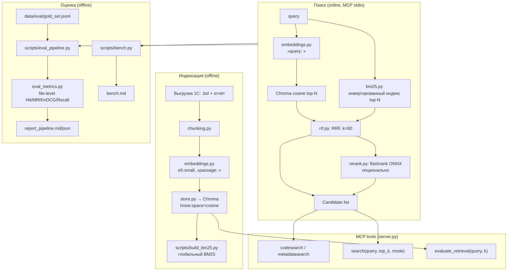

# Архитектура

Документ описывает устройство проекта на уровне компонентов и потоков данных.
Ключевые компромиссы зафиксированы в [ADR](docs/adr/), результаты замеров —
в [data/eval/report_pipeline.md](data/eval/report_pipeline.md) и [data/eval/bench.md](data/eval/bench.md).

## 1. Цели и не-цели

**Цели**

- MCP-сервер (stdio), который отдаёт агенту поиск по выгрузке 1С: BSL-код и отчёт конфигурации.
- Полностью локальный RAG-контур без Docker и без внешних API.
- Воспроизводимый замер качества: метрики, gold-set, сравнение конфигураций.
- Код и архитектура как портфолио: тесты, линтеры, CI, документация решений.

**Не-цели (сознательно вне MVP)**

- Публикация выгрузки 1С и чужого векторного индекса.
- Обучение собственной embedding-модели, fine-tune, GPU-инфраструктура.
- Продакшен- SLA: проект учебный, но инженерно дисциплинированный.

## 2. Компоненты

| Модуль | Ответственность |
|---|---|
| `chunking.py`, `indexer.py` | нарезка `.bsl` и отчёта на чанки (перекрытие, ограничения размера), запись в Chroma |
| `embeddings.py` | обёртка e5-small: префиксы `query:` / `passage:`, нормализация |
| `store.py` | открытие Chroma-коллекций (`code`, `metadata`), базовый запрос |
| `bm25.py` | токенизация под 1С, `BM25Okapi` для кандидатов и `Bm25Index` — глобальный инвертированный индекс |
| `rrf.py` | Reciprocal Rank Fusion по рангам |
| `rerank.py` | cross-encoder второй стадии (flashrank, ONNX, CPU) |
| `search_modes.py` | единый фасад: `vector` / `hybrid` / `hybrid_rerank` / `pearson` |
| `models.py` | `Candidate` — лёгкая модель результата (без тяжёлых импортов) |
| `eval_metrics.py` | метрики качества, чистые функции |
| `server.py` | MCP-сервер и описания tools |
| `index_guard.py` | запрет открывать индекс во время записи |

## 3. Потоки данных

**Индексация:** исходники → чанки → эмбеддинги (с префиксом `passage:`) →
Chroma (cosine, HNSW) → отдельно глобальный BM25 (`data/bm25`, npz + json).

**Запрос (режим `hybrid`, дефолт):**

1. `embed_query` кодирует запрос с префиксом `query:`;
2. Chroma отдаёт top-N по cosine;
3. `Bm25Index` отдаёт top-N по BM25 (инвертированный индекс, скоринг только по постингам);
4. `rrf_fuse` объединяет два ранжирования: `score = Σ 1/(k_rrf + rank)`;
5. результат форматируется для MCP-клиента.

**Запрос (`hybrid_rerank`):** к шагам 1–4 добавляется cross-encoder над 20 кандидатами.

**Eval:** gold-set → 4 конфигурации → построчный расчёт метрик → агрегаты →
markdown/JSON отчёт. Релевантность — на уровне файла-источника.

## 4. Хранение

| Каталог | Что | В git |
|---|---|---|
| `data/chroma/` | Chroma: sqlite + сегменты HNSW | нет |
| `data/bm25/` | `index.npz` + `meta.json` (глобальный BM25) | нет |
| `data/eval/` | gold-set, отчёты eval/bench | только `gold_set.jsonl` и отчёты |
| `vacancies/`, `cover_letters/`, `resume_profile.md` | личные данные | нет |

## 5. Производительность

Замеры — `scripts/bench.py` → [data/eval/bench.md](data/eval/bench.md).
Порядок величин на CPU: `vector` и `hybrid` — десятки миллисекунд,
`hybrid_rerank` — секунды (ONNX cross-encoder). BM25-индекс по 124 тыс. чанков
собирается за ~9 с и занимает ~51 МБ на диске.

## 6. Ограничения и риски

1. **HNSW не персистится на диск** при `hnsw:sync_threshold=1000000` — это
   осознанная защита от [chroma#7090](https://github.com/chroma-core/chroma/issues/7090);
   векторы лежат в sqlite/WAL, HNSW пересобирается при старте процесса (~60–70 с).
2. **Reranker обучен на веб-пассажах**, а не на BSL-коде: по замерам ухудшает
   метрики, поэтому включён опционально.
3. **Gold-set частично синтетический**: авто-часть выведена из реальных файлов,
   поэтому абсолютные метрики скромные; сравнение конфигураций корректно.
4. **Один писатель**: индексатор держит lock; параллельная индексация не поддерживается.

## 7. Точки расширения

- Новый сигнал ранжирования → функция в `search_modes.py` + список в `rrf_fuse`.
- Другая reranker-модель → `MCP_1C_RERANK_MODEL` (flashrank), без правки кода.
- Другой корпус → `MCP_1C_STUDY_ROOT` / `MCP_1C_STUDY_REPORT_ROOT`, пересборка индекса.
- Новый MCP-tool → декоратор `@mcp.tool()` в `server.py`.
