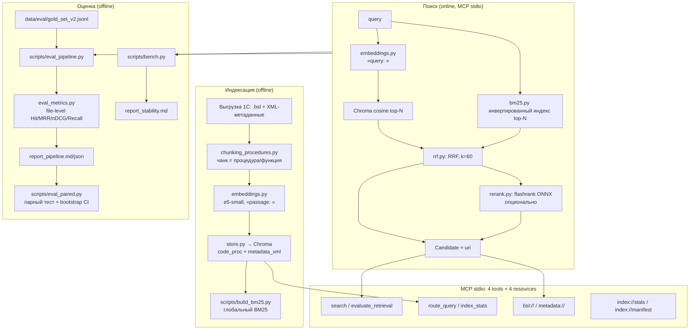

# Архитектура

Документ описывает устройство проекта на уровне компонентов и потоков данных.
Ключевые компромиссы зафиксированы в [ADR](adr/), актуальные метрики — в
[EVALUATION.md](EVALUATION.md), отчёты замеров — в
[data/eval/README.md](../data/eval/README.md).

## 1. Цели и не-цели

**Цели**

- MCP-сервер (stdio), который отдаёт агенту поиск по выгрузке 1С: BSL-код и
  XML-метаданные конфигурации.
- Полностью локальный RAG-контур без внешних API.
- Воспроизводимый замер качества: метрики, gold-set, сравнение конфигураций.
- Код и архитектура как портфолио: тесты, линтеры, CI, документация решений.

**Не-цели (сознательно вне MVP)**

- Публикация выгрузки 1С и чужого векторного индекса.
- Обучение собственной embedding-модели, fine-tune, GPU-инфраструктура.
- Продакшен-SLA: проект учебный, но инженерно дисциплинированный.

## 2. Компоненты

| Модуль | Ответственность |
|---|---|
| `chunking.py`, `chunking_procedures.py`, `indexer.py` | нарезка `.bsl` (символьные окна и процедурная), XML-метаданных — на объекты/поля, запись в Chroma |
| `chunking_tokens.py`, `chunking_xml_tokens.py` | экспериментальная нарезка по токенам; в обслуживаемый индекс не входят |
| `embeddings.py` | обёртка e5-small: префиксы `query:` / `passage:`, нормализация |
| `store.py` | открытие Chroma-коллекций (`code_proc`, `metadata_xml`; исторические `code`, `metadata`), базовый запрос |
| `bm25.py` | токенизация под 1С, `BM25Okapi` для кандидатов и `Bm25Index` — глобальный инвертированный индекс |
| `rrf.py` | Reciprocal Rank Fusion по рангам |
| `rerank.py` | cross-encoder второй стадии (flashrank, ONNX, CPU) |
| `search_modes.py` | единый фасад: `vector` / `hybrid` / `hybrid_rerank` / `pearson` / `lexical` |
| `search_context.py` | `SearchContext`: ленивые кэши BM25 / prefix-масок / count коллекций; `search_modes.default_context` — процессный default (P1a, без смены scoring) |
| `formatting.py` | текстовое представление кандидатов (`format_candidates`); re-export из `search_modes` |
| `merge.py` | `merged_search`: объединение коллекций с нормализацией `max` (дефолт) / `rrf` / `minmax` (ADR 0011) |
| `router.py` | контракт выбора инструмента lexical / vector / hybrid |
| `models.py` | `Candidate` — лёгкая модель результата (без тяжёлых импортов) |
| `eval_metrics.py` | метрики качества, чистые функции |
| `server.py` | MCP stdio: 4 tools (`search`, `evaluate_retrieval`, `route_query`, `index_stats`) и 4 resources |
| `resources.py` | чтение модуля BSL с диска и карточки XML-метаданных из Chroma |
| `uris.py` | `bsl://` и `metadata://` (только stdlib) |
| `warmup.py` | фоновая загрузка HNSW, BM25 и e5 после старта |
| `observability.py` | stderr-only logging + in-memory метрики; health через `index_stats` / `health_snapshot` (без 5-го MCP tool) |
| `manifest.py` | индекс-манифест (counts/fingerprint); startup — быстрый путь; полный hash — build_manifest/eval (ADR 0012) |
| `index_guard.py` | запрет открывать индекс во время записи |

## 3. Потоки данных

**Индексация:** исходники → чанки (процедуры для `.bsl`, объекты/поля для XML) →
эмбеддинги (с префиксом `passage:`) → Chroma (cosine, HNSW) → отдельно глобальный
BM25 (`data/bm25_all`, npz + json; 179 586 чанков, 236 320 термов, ~81 МБ);
токенизатор разбивает CamelCase/snake_case (ADR 0010).

**Запрос (режим `hybrid`, дефолт):**

1. `embed_query` кодирует запрос с префиксом `query:`;
2. Chroma отдаёт top-N по cosine;
3. `Bm25Index` отдаёт top-N по BM25 (инвертированный индекс, скоринг только по постингам);
4. `rrf_fuse` объединяет два ранжирования: `score = Σ 1/(k_rrf + rank)`;
5. результат форматируется для MCP-клиента; у хита кода — `uri=bsl://<путь>`, у карточки метаданных — `uri=metadata://<вид>/<имя>`. `index://stats` отдаёт тот же текст, что `index_stats`; `index://manifest` — JSON манифеста. Оба не открывают Chroma.

**Запрос (`hybrid_rerank`):** к шагам 1–4 добавляется cross-encoder над 20 кандидатами.

**Eval:** gold-set v2 → конфигурации → построчный расчёт метрик → агрегаты →
markdown/JSON отчёт; парный тест `eval_paired.py` (bootstrap CI + paired t-test)
по per-query значениям. Релевантность — на уровне файла-источника.

## 4. Хранение

| Каталог | Что | В git |
|---|---|---|
| `data/chroma_xml/` | Chroma текущего корпуса: `code_proc` (154 560) + `metadata_xml` (25 026) | нет |
| `data/chroma/` | Chroma для ablation-ячейки: символьная нарезка + исторические `metadata` | нет |
| `data/bm25_all/` | `index.npz` + `meta.json` (глобальный BM25, 179 586 чанков) | нет |
| `data/eval/` | gold-set, отчёты eval/bench/paired/ablation | только наборы и отчёты |

## 5. Производительность

Замеры — `scripts/bench.py` и
[`data/eval/code_proc/report_stability.md`](../data/eval/code_proc/report_stability.md).
Порядок величин на CPU: `vector` и `hybrid` — десятки миллисекунд,
`hybrid_rerank` — секунды (ONNX cross-encoder). BM25-индекс по 179 тыс. чанков
занимает ~81 МБ на диске; это отдельный шаг сборки (`scripts/build_bm25.py`).

## 6. Observability

Логи только в **stderr** (stdout занят MCP stdio). Логгер `mcp_1c_rag`:
`MCP_1C_LOG_LEVEL` (default `WARNING`), `MCP_1C_LOG_JSON=1` — JSON-строки,
`MCP_1C_LOG_QUERIES=1` — opt-in на текст запроса (иначе `query_chars` /
`query_hash`). Счётчики запросов/ошибок/latency — in-memory; готовность и
метрики отдаёт расширенный `index_stats` (поля `status`, `requests_total`, …).
Отдельного health-tool нет.

## 7. Ограничения и риски

1. **HNSW не персистится на диск** при `hnsw:sync_threshold=1000000` — это
   осознанная защита от [chroma#7090](https://github.com/chroma-core/chroma/issues/7090);
   векторы лежат в sqlite/WAL, HNSW пересобирается при старте процесса (~60–70 с).
2. **Reranker обучен на веб-пассажах**, а не на BSL-коде: ухудшает метрики,
   поэтому включён опционально (ADR 0002).
3. **Gold-set частично синтетический**: авто-часть выведена из реальных файлов,
   поэтому абсолютные метрики скромные; сравнение конфигураций корректно.
4. **Один писатель**: индексатор держит lock; параллельная индексация не поддерживается.
5. **Старая выгрузка недоступна**: клетку 2×2 «старая выгрузка × процедурная
   нарезка» измерить нельзя; остальные клетки сняты до ADR 0010 и требуют
   перезамера — см. [HISTORY.md](HISTORY.md) и
   [`data/eval/ablation_2x2.md`](../data/eval/ablation_2x2.md).
6. **Инкрементального обновления нет**: после изменения выгрузки индекс
   пересобирается целиком; прерванную сборку можно возобновить.
7. **`bsl://` отдаёт модуль целиком** (до 5 МиБ). Выбор процедуры `?proc` —
   roadmap, не реализован.
8. **Токенные чанкеры** (`chunking_tokens.py`, `chunking_xml_tokens.py`) не
   входят в обслуживаемый индекс. `config_xml` в текущий индекс не добавлен.
9. **Прогрев держит GIL** при загрузке модели и пересборке HNSW (десятки
   секунд). Для текущего stdio это известное ограничение; для HTTP это риск
   недоступности на время прогрева. В этой версии HTTP нет.

## 8. Точки расширения

- Новый сигнал ранжирования → функция в `search_modes.py` + список в `rrf_fuse`.
- Другая reranker-модель → `MCP_1C_RERANK_MODEL` (flashrank), без правки кода.
- Другой корпус → `MCP_1C_STUDY_ROOT` / `MCP_1C_METADATA_XML_ROOT`, пересборка индекса.
- Новый MCP-tool → декоратор `@mcp.tool()` в `server.py`.
