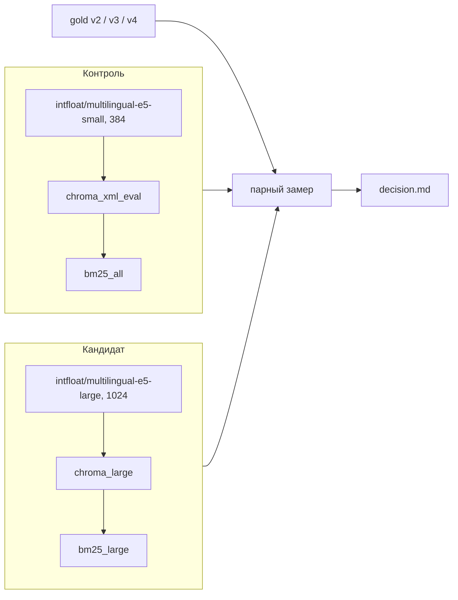

# План: кандидат рабочего индекса (e5-large, BSL и XML)

- **Версия:** 2.15
- **Дата:** 2026-11-02
- **Статус:** черновик. К сборке не готов: стыковка §6.0 не сделана. Этот файл не разрешает сборку.
- **Машина:** Intel Core i5-12450H, 16 ГБ ОЗУ, дискретной GPU нет. Сборка и замер на CPU.
- **Связь с v2.14:** гейты §6.2.4 вызывает `scripts/verify_candidate_gates.py` до BM25. В §12 выписаны команды кандидата и пример спуска upsert через `MCP_1C_CHROMA_ADD_BATCH`. Сеанс команд — PowerShell.

## 1. Вопрос

Можно ли назначить кандидатом замены текущий рабочий поиск.

Рабочий контур остаётся на месте до отдельной команды после `decision.md`. Этот план доходит до решения и не переключает `MCP_1C_EMBEDDING_MODEL`, `MCP_1C_CHROMA_DIR`, `MCP_1C_BM25_DIR`, `MCP_1C_SEARCH_MODE`.

Δ nDCG@10 и в vector, и в hybrid по коду — свойство связки «модель + нарезка BSL + XML + BM25». Отдельный вывод «e5-large лучше e5-small» из этого замера не делается. Назначение смотрит на vector: так записано в конфиге сервера, даже пока сам процесс остановлен. Наборов с разметкой по сырым XML в gold-set нет, поэтому качество XML в ворота nDCG не входит. Отсутствие коллекции XML сборку отменяет.

В `1C_Corpus` на 2026-11-01 лежит 16 385 файлов `.xml`, из них 1 931 в `Reports`. Все непустые индексируются. Карточки `metadata_xml` остаются отдельно и эти файлы не покрывают. `1C_Corpus_Report\ОтчетПоКонфигурации.txt` не индексируется: это плоский пересказ тех же объектов. Модули отчётов (385 `.bsl`) идут в код, их XML — в `config_xml`.

## 2. Два контура, один контракт поиска

Оба контура проходят через те же компоненты: `embeddings.py` (`passage:` / `query:`), `store.py`, `scripts/build_bm25.py`, `search_modes.py` (фильтр id по префиксу, RRF k = 60, пул `HYBRID_TOP_K` = 50), `scripts/eval_pipeline.py` (k = 10, релевантность на уровне файла). Меняется плоскость данных, не контракт поиска.



| | Контроль | Кандидат |
|---|---|---|
| Chroma | готовая копия `data/chroma_xml_eval` | `data/chroma_large` |
| BM25 | `data/bm25_all`, только чтение | `data/bm25_large`, собран из кандидата |
| Модель запроса и индекса | `intfloat/multilingual-e5-small` | `intfloat/multilingual-e5-large` |
| Размерность | 384 | 1024 |
| `code_proc` | 154 560 чанков, префикс `bsl_proc:`, старая нарезка | token-aware нарезка, то же имя коллекции и тот же префикс |
| `metadata_xml` | 25 026 чанков, префикс `metaobj:` | те же тексты и те же id `metaobj:`. Это карточки, не файлы XML |
| `config_xml` | в контроле нет | каждый непустой `.xml` из `1C_Corpus`, префикс `xml:` |
| Замер | hybrid и vector, k = 10 | то же |
| Что отдаёт MCP | `MCP_1C_SEARCH_MODE=vector` в `cordis.patch.yml` | этот план строку не меняет |

Коллекция `code` в `chroma_xml` в замер не входит. Дефолт `MCP_1C_CODE_COLLECTION` в коде — `code`. Каждый прогон передаёт `--collection` явно: `code_proc` или `metadata_xml`.

Один процесс — одна модель: `get_model()` кэшируется на процесс. Плечи не сравниваются внутри одного процесса.

Окружение, прочитанное из `.venv` 2026-11-01: Python 3.14.6, sentence-transformers 6.1.0, torch 2.14.1+cpu, transformers 5.20.1, chromadb 1.5.9, numpy 2.5.4, scipy 1.18.1. Это версии этой машины, не перенос из документации. Preflight печатает их снова. Расхождение пишется в `state.json`, §2 обновляется до сборки, не после. Если отличаются `sentence-transformers` или `torch`, пилот не начинается: от них зависят размерность и токенизация. Прочие пакеты из списка расхождение только фиксируют. Интерпретатор всех команд — `D:\MCP_1С_homework\.venv\Scripts\python.exe`, каталог запуска — `D:\MCP_1С_homework`. Код и XML читаются только из `1C-Corpus\1C_Corpus`. Имени `1C_Corpus` без дефиса в командах нет. `1C-Corpus\1C_Corpus_Report\ОтчетПоКонфигурации.txt` не индексируется. Системный Python не использовать.

Живой поиск на время этого плана не нужен: пользователем сервера никто не будет. До замера свободной памяти процессы `python -m mcp_1c_rag` останавливаются. Номера PID с 2026-11-01 (3776, 9060) заранее не считать живыми: перед остановкой сверить командную строку. Конфиг `.dsh-bundles/1c-mcp-rag-search/cordis.patch.yml` не править. Он по-прежнему читает `chroma_xml` и `bm25_all` и задаёт режим vector. Включение сервера — отдельная команда после `decision.md`. Дефолт в `config.py` при этом hybrid. Ворота назначения индекса — режим vector из конфига.

## 3. Что меняется внутри кандидата

1. **Код.** `chunk_bsl_file_tokens` (max_tokens=500, overlap_tokens=64, min_tokens=32, max_chars=2000). Бюджет считается токенизатором `intfloat/multilingual-e5-large` так же, как `embed_passages`: `passage:` + префикс файла/процедуры + спецтокены. Id: `bsl_proc:<sha1(source)[:16]>:<chunk_index>`.
2. **Модель.** `intfloat/multilingual-e5-large` на коде, на карточках метаданных и на файлах XML. В каталоге кэша large файл `refs/main` указывает на snapshot `3d7cfbdacd47fdda877c5cd8a79fbcc4f2a574f3` (1024). В каталоге кэша small свой `refs/main` указывает на `614241f622f53c4eeff9890bdc4f31cfecc418b3` (384). В отчёт пишется фактический rev, SHA-256 `config.json`, лицензия и список файлов snapshot с размерами. Ненулевой размер обязателен у `config.json`, `tokenizer.json`, `sentencepiece.bpe.model`, `model.safetensors`. Пустой или неполный snapshot — стоп. Повторно модель в середине эксперимента не скачивается.
3. **BM25.** Один глобальный индекс на префиксы `bsl_proc:`, `metaobj:` и `xml:`. IDF общий. Смена состава документов меняет лексические веса всех коллекций. Это часть Δ связки. Отдельный BM25 на коллекцию не строится.
4. **Файлы XML.** Отдельный чанкер, не `chunk_bsl_file_tokens`: в XML нет границ процедур. Токенизатор тот же, `intfloat/multilingual-e5-large`. Бюджет тот же: полный вход модели ≤ 500 токенов, перекрытие 64, хвост короче 32 приклеивается, потолок 2000 символов. Режется по границам тегов и строк, невлезающий кусок — по токенам. Id: `xml:<sha1(source)[:16]>:<chunk_index>`. `source` — путь от `1C_Corpus`. `EXCLUDE_KINDS` на эти файлы не действует. Коллекция `config_xml`. В `search_modes._ID_PREFIX` добавляется `config_xml` → `xml:`.

Карточки `metadata_xml` по текстам не перенарезаются. Они не считаются индексацией XML. Векторный канал карточек при совпадении id меняет только модель. В ворота nDCG он не входит: в v3 таких запросов 5.

## 4. Что обязано совпасть

Иначе hybrid молча теряет лексическое плечо или сравнивает разные документы.

| Контракт | Факт в коде и на диске | Следствие для кандидата |
|---|---|---|
| Префикс кода | `search_modes._ID_PREFIX["code_proc"] = bsl_proc:` | id чанкера уже такие |
| Префикс метаданных | фильтр коллекции `metadata_xml` — `metaobj:` | `chunks.jsonl` — 26 450 строк, все id `meta_upp:`. Копию делает `scripts/rewrite_meta_prefix.py`: те же тексты, префикс `metaobj:` |
| Состав метаданных | `EXCLUDE_KINDS` применяется в `build_metadata_index.py` при чтении `--chunks`, не при изготовлении копии | из 26 450 в коллекцию попадают 25 026. Пост-билд гейт — 25 026 id `metaobj:`. Множество этих id равно id `metadata_xml` в `chroma_xml`. Иначе стоп |
| Токенизатор нарезки | `chunking_tokens.get_tokenizer()` аргументов не принимает и загружает e5-small | стыковка даёт `get_tokenizer(model_name)`. Сухой прогон и обе сборки вызывают его с `intfloat/multilingual-e5-large`. Отдельного прогона small и перевода на large нет. Чанк длиннее 512 — ошибка чанкера, стоп до эмбеддингов |
| Модель сборки кода | `scripts/build_token_index.py` записывает e5-small поверх окружения | до пилота флаг `--embedding-model`; без флага скрипт не подменяет модель. Смоук: dim 1024 |
| Модель замера | `scripts/run_eval_runs.py` выставляет каталоги Chroma и BM25 и не выставляет модель | до замера флаг `--embedding-model` уходит в окружение дочернего процесса |
| Порог HNSW | код выставляет `MCP_1C_HNSW_SYNC_THRESHOLD=1000000`; метаданные — нет | оба процесса кандидата получают это значение до импорта `config.py` |
| Два размера пачки | `--batch-size` — шаг `encode`. Шаг upsert — константа `CHROMA_ADD_BATCH`: она читает окружение `MCP_1C_CHROMA_ADD_BATCH`, по умолчанию 64. Отдельного флага у скрипта нет | пилот называет оба числа. Пример спуска в §12 задаёт `$env:MCP_1C_CHROMA_ADD_BATCH` |
| Блокировка записи | `data/index.lock` один на весь `data/` | сервер поиска уже остановлен, поэтому сборка занимает этот lock. `--no-lock` не использовать. Второй писатель в `chroma_large` не запускать |

`EXCLUDE_KINDS` относится только к карточкам `metadata_xml`: CommonPicture, Style, StyleItem, Interface, Language, WSReference, XDTOPackage, Role. На файлы `.xml` этот список не распространяется. `ОтчетПоКонфигурации.txt` в индекс не берётся. Модули `.bsl` внутри `Reports` (385 файлов) идут в `code_proc` вместе с остальным кодом.

## 5. Gold-set (файл, не старая публикация)

Проверено по файлам 2026-11-01. Preflight повторяет подсчёт и пишет SHA-256.

| Файл | Состав | Как фильтровать |
|---|---|---|
| `gold_set_v2.jsonl` | 70 строк, поля `scope` нет, 68 уникальных `.bsl` | без `--scope` |
| `gold_set_v3_holdout.jsonl` | 64 code + 5 metadata + 31 none | code: `--scope code`; metadata: `--scope metadata` |
| `gold_set_v4_holdout.jsonl` | 179 code + 6 none | `--scope code` |

Объединение code-`.bsl` из трёх файлов на 2026-11-01 — 220 путей. Это не сумма 70+64+179: пути пересекаются. Preflight пересчитывает объединение и пишет его в `state.json`. Гейт пилота равен этому пересчёту.

Доверяем файлам, не передаче. Передача пишет v3 как 71 code + 24 none. Опубликованный hybrid 0,217 снят на 71 code-запросе и с новым v3 (64 code) не сравнивается. SHA опубликованного v2, давшего 0,442 ± 0,012, в репозитории нет.

Старые прогоны к текущим файлам не подходят, пока не совпали SHA gold-set, имя коллекции, размерность и revision модели. Иначе плечо снимается заново.

## 6. Фазы

Каждая фаза пишет отчёт в каталог из §10 и обновляет `state.json`. Следующая фаза не начинается, если стоп-условие сработало.

### 0. Стыковка и preflight

Стыковка — маленькие правки до любой сборки. Индексация их не заменяет.

Пока пункты 1–8 не в коде и пункт ignore не подтверждён `git check-ignore`, пилот и полная сборка не запускаются.

1. `chunking_tokens.get_tokenizer(model_name)` — аргумент обязателен, значения по умолчанию нет. Имя этой сборки: `intfloat/multilingual-e5-large`. Кэш ключуется по `model_name`. То же имя проходит в `model_input_tokens`, `_split_long_line`, `_split_body_tokens` и в публичный `chunk_bsl_file_tokens` (через `chunk_bsl_text_tokens`): они вызывают `get_tokenizer(model_name)`, а не загрузчик без аргумента. `scripts/build_token_index.py` и `scripts/chunk_corpus_tokens.py` принимают `--embedding-model` и передают его в `chunk_bsl_file_tokens`. Запись e5-small в окружение из `build_token_index.py` удаляется. Вызовы без аргумента в `tests/test_chunking_tokens.py`, `scripts/chunk_corpus_tokens.py` и `scripts/verify_token_index.py` передают имя явно. Тесты нарезки передают `intfloat/multilingual-e5-large`: они проверяют ту же нарезку, что и кандидат. Сухой прогон и сборка передают large. `chunk_corpus_tokens.py` печатает имя токенизатора. Имя модели эмбеддинга и dim 1024 печатает `build_token_index.py`, не сухой чанкер. `verify_token_index.py` только получает `model_name`. Гейты §6.2.4 он не выполняет: скрипт смотрит `data/chroma_token`, dim 384 и только `bsl_proc:`. Флага у скрипта без этой правки функции недостаточно: нарезка останется на e5-small.
2. `run_eval_runs.py`: аргумент `--embedding-model` в окружение дочернего процесса до импорта `config.py`.
3. Id метаданных: `scripts/rewrite_meta_prefix.py` пишет `data/metadata_xml/chunks_metaobj.jsonl`, заменяя префикс `meta_upp:` на `metaobj:`. Тексты те же. Сборка вызывает `build_metadata_index.py --chunks` на эту копию. В коллекции нет ни одного `meta_upp:`.
4. `scripts/select_pilot_corpus.py` сейчас читает только `gold_set_v2.jsonl` (68 `.bsl`) и пишет в `data/token_pilot_corpus`. После стыковки обязателен повторяемый `--gold`. Команда плана передаёт три файла. Запуск без трёх `--gold` — стоп, молчаливый v2 запрещён. Выход `data/large_pilot_corpus`, целевой размер 300–500. В копии должны быть все пути объединения из §5, не только 68.
5. XML — отдельные скрипты, не режим `build_token_index.py`. `scripts/chunk_xml_corpus_tokens.py` делает сухой прогон. `scripts/build_xml_index.py` пишет коллекцию `config_xml` и принимает те же флаги, что сборка кода: `--root`, `--chroma-dir`, `--collection`, `--checkpoint`, `--embedding-model`, `--batch-size`, `--reset`. Оба вызывают `get_tokenizer(model_name)` с именем из `--embedding-model`. Своего загрузчика токенизатора у XML нет. `build_xml_index.py` принимает `--checkpoint-interval` с умолчанием 50, как `build_token_index.py`. В командах §12 флаг не передаётся: действует 50. В `search_modes.py` префикс `config_xml` → `xml:`.
6. `scripts/record_control_delta.py` по прогонам контроля считает std vector nDCG@10 и пишет в `state.json` фактические δ v2, v3 и v4. Запуск кандидата до этого файла запрещён.
7. `scripts/smoke_search.py` уже есть, проверен по файлу 2026-11-01. Флаги уже есть: `--chroma-dir`, `--bm25-dir`, `--collection`, `--query` (ещё `--top-k`, по умолчанию 10). Сейчас печатает `source` и score первого попадания и строку `SMOKE_PASS` / `SMOKE_FAIL`. Поле `Candidate.id` не печатает. Модель эмбеддинга не подменяет: если окружение её не задало, импорт `config` берёт e5-small и смоук по индексу 1024 падает. Стыковка пункта: печатать `id` первого попадания режима hybrid и завершаться с ненулевым кодом, если у `code_proc` он не начинается с `bsl_proc:`, у `metadata_xml` — с `metaobj:`, у `config_xml` — с `xml:`, или если попаданий нет. Окружение §12 задаёт `MCP_1C_EMBEDDING_MODEL=intfloat/multilingual-e5-large` до запуска. Пока пункт 7 не в коде, смоук §6.2.6 не считается пройденным, даже если старый скрипт вернул ноль.
8. Новый `scripts/verify_candidate_gates.py` выполняет гейты §6.2.4 и только их. `verify_token_index.py` для этого не используется. Флаги: `--chroma-dir`, `--bsl-dry`, `--xml-dry`, `--xml-root`, повторяемый `--gold` (три файла §5). Ненулевой код, если не выполнено любое из следующего: коллекции ровно `code_proc`, `config_xml`, `metadata_xml`; dim каждого вектора 1024 и ни одна коллекция не пуста; число чанков кода равно числу в сухом прогоне BSL, число чанков XML — числу в сухом прогоне XML, пустых текстов нет; в `code_proc` нет id `xml:`; в `config_xml` каждый id начинается с `xml:`, множество `source` равно множеству непустых `.xml` под `--xml-root`; в `metadata_xml` 25 026 id и все они `metaobj:`; каждый code-`relevant_sources` из трёх gold есть в `source` после замены `\` на `/`. Длину токенов скрипт заново не считает. До нулевого кода этого скрипта BM25 не собирать.

Preflight:

1. Модель large: rev, dim 1024, SHA-256 `config.json`, лицензия, список файлов snapshot с размерами (§3). Версии пакетов из §2 печатаются из `.venv`.
2. `python -m pytest tests/test_chunking_tokens.py tests/test_eval_report_pair.py -q` тем же интерпретатором. Функция `chunk_bsl_file_tokens` есть; зелёность на текущем дереве этой правкой не перепроверялась. Красный прогон — стоп: стыковка расширяется реализацией, пилот не начинается.
3. Сухой прогон кода и XML сразу токенизатором `intfloat/multilingual-e5-large`, бюджет 500. `ОтчетПоКонфигурации.txt` в прогон не входит. Результаты пишутся в каталог §10. В `state.json` — число чанков, max токенов и число чанков длиннее 512, отдельно для кода и для XML, плюс покрытие и список `source`. Без этих чисел ETA не считается и ни пилот, ни полная сборка не начинаются. Чанк длиннее 512 — ошибка чанкера, эмбеддинги не считаются. Повторного прогона токенизатором small нет. Передача называет 153 990 чанков кода и покрытие 99,98 %. Файла с тем прогоном нет, число не переносится. Число чанков XML заранее не выдумано: его даёт этот прогон.
4. Все code-`relevant_sources` из v2/v3/v4 есть среди `source` сухого прогона. Пустые и BOM-only файлы чанков не дают. Пять metadata-путей v3 в этот гейт не входят. Формат: на 2026-11-01 `source` в `chroma_xml_eval` — относительный путь вроде `AccountingRegisters/.../RecordSetModule.bsl`, без префикса `1C_Corpus/`. Gold выглядит так же. Preflight сравнивает одну строку gold и один `source` после замены `\` на `/`. Не совпал вид пути — стоп, гейт не подгонять молча.
5. Копия `chunks_metaobj.jsonl` содержит 26 450 строк. После `EXCLUDE_KINDS` внутри `build_metadata_index.py` остаётся 25 026 id, и это множество равно id `metadata_xml` в `chroma_xml`. Девять текстов длиннее 2 000 символов (максимум 2 857) считаются токенизатором large. Если хотя бы один длиннее 512, это риск усечения метаданных, не стоп и не повод менять нарезку. Решение по таким карточкам — отдельный план. В этот замер метаданные не входят.
6. SHA-256 трёх gold-set и составы из §5, включая пересчёт объединения `.bsl`.
7. Диск: свободно ≥ 30 ГБ до старта. Копия контроля уже лежит (2,19 ГБ) и в прогноз размера второй раз не входит. После пилота оценка кандидата — от байт/чанк пилота × сумма чанков сухого прогона кода и XML, плюс 25 026 карточек. После артефактов должно оставаться ≥ 10 ГБ, иначе стоп.
8. `.gitignore` до появления артефактов. На 2026-11-01 этих путей в файле нет: `data/chroma_large/`, `data/chroma_large_pilot/`, `data/bm25_large/`, `data/eval/_runs_large/`, `data/large_pilot_corpus/`, `data/procedure_index_progress_large*.json`. Соседние строки `data/chroma_pilot_large/` и `data/eval/_runs_1c/` их не закрывают. Каждый новый путь проходит `git check-ignore`. Иначе стоп.
9. Контроль брать из `data/chroma_xml_eval`, заново `chroma_xml` не копировать. На 2026-11-01 у копии `PRAGMA integrity_check` = ok, `code_proc` = 154 560 (`bsl_proc:`), `metadata_xml` = 25 026 (`metaobj:`), dim 384, `hnsw:sync_threshold` = 1000000, размер базы 2,19 ГБ. Preflight повторяет counts и dim одного вектора. Равенство id — равенство множеств `doc_ids` в `bm25_all` и id копии, порядок не важен. Ожидание — 179 586. Расхождение — стоп, без перекопирования.
10. Сборку карточек запускать только с `--reset` у `build_metadata_index.py`. Отдельный `delete_collection` перед скриптом не вызывать: скрипт сам удаляет коллекцию `metadata_xml` и создаёт её заново. Preflight перечитывает `get_collection`. Если `--reset` начнёт удалять каталог Chroma целиком — стоп, команду не запускать.
11. Недоделанные каталоги `chroma_token`, `chroma_token_pilot`, `chroma_e5_large` и чекпоинт `procedure_index_progress_token.json` на диске отсутствуют. Их не восстанавливать. У кандидата свой чекпоинт.

### 1. Пилот ресурсов

Пилот не измеряет качество. Корпус неполный, nDCG с него в решение не входит.

1. Сначала остановить процессы сервера поиска, как в §2. Убедиться, что процессов `python -m mcp_1c_rag` не осталось.
2. Копия только скриптом из стыковки, пункт 4. В каталоге 300–500 `.bsl`, среди них все пути объединения из §5, плюс стратификация тип×размер. Seed записать. Если скрипт по-прежнему берёт один v2, пилот не начинать.
3. Сборка в `data/chroma_large_pilot` через `--root` этой копии, без `--files` и без `--no-lock`. Модель — аргументом large. Чекпоинт пилота отдельный. Флаг `--embedding-model` обязателен и до стыковки, и после неё: команда без флага не запускается. До стыковки текущий скрипт ещё и подменяет модель на e5-small. После стыковки подмена удалена, флаг всё равно остаётся в команде, чтобы модель была явной.
4. Свободную память записать уже после остановки сервера. 3 ГБ в формуле — запас под ОС, не под индексатор и не под остановленный MCP. Потолок RSS индексатора — min(11 ГБ, свободно на старте − 3 ГБ). Свободно меньше 5 ГБ — стоп, пилот не начинать: это нехватка машины до старта, не размер пачки. Сначала две сборки в один каталог `data/chroma_large_pilot`: `--batch-size` 8 и 16, upsert 64 (переменную `MCP_1C_CHROMA_ADD_BATCH` не задавать: это умолчание константы `CHROMA_ADD_BATCH`), у каждой свой чекпоинт. Обе с `--reset`. Если 16 выходит за потолок, эту точку отбрасывают. Если 8 тоже выходит, уменьшают пачку эмбеддинга: 4, затем 2, затем 1. Если и 1 не входит, уменьшают upsert: 32, затем 16, затем 8, при `--batch-size` 1. Upsert задаётся только окружением `$env:MCP_1C_CHROMA_ADD_BATCH` в сеансе PowerShell, не флагом. Пример одной такой точки — в §12. В `state.json` пишется каждая измеренная тройка (batch эмбеддинга, upsert, chunks/s, RSS). В полную сборку берётся самая быстрая пара внутри потолка. Стоп только если `--batch-size` 1 и upsert 8 всё ещё выше потолка: тогда не влезает сама модель.
5. В `state.json` до полной сборки: chunks/s, files/s, peak RSS, байт/чанк, ETA кода, XML и 25 026 карточек, прогноз латентности. На пилоте один и тот же запрос гоняется режимами vector и hybrid: это единицы времени, не качество. В решение входят латентности полного замера обоих режимов.

Стоп до полной сборки, если прогноз «сборка + оба плеча замера» больше 96 часов. Часы считаются от записи go в `state.json` после пилота, не от начала пилота. Туда же: диск после прогноза < 10 ГБ или RSS не уложился в порог.

### 2. Полная сборка кандидата

Порядок: код, XML, затем карточки метаданных в тот же каталог Chroma, затем BM25. Сброс одной коллекции не удаляет остальные. Каталог `data/chroma_xml` не открывать на запись. `ОтчетПоКонфигурации.txt` не читать.

1. `code_proc`: аргумент модели `intfloat/multilingual-e5-large`, без `--no-lock`, параметры чанкера из §3, пачка из пилота, чекпоинт `data/procedure_index_progress_large.json` каждые 50 файлов. Это умолчание `--checkpoint-interval` у `build_token_index.py`. В §12 флаг не передаётся. Лог: files, chunks, chunks/s, ETA, RSS, свободный диск. Возобновление только этого чекпоинта. Условие: длина одного вектора равна 1024 и число записей коллекции равно числу в чекпоинте. Полный перебор векторов не требуется: модель пишет одну размерность. Пустая коллекция при ненулевом чекпоинте — стоп.
2. `config_xml`: все непустые `.xml` из `1C-Corpus/1C_Corpus`, чанкер из §3 пункта 4, модель `intfloat/multilingual-e5-large`, чекпоинт `data/procedure_index_progress_large_xml.json` каждые 50 файлов. Это то же умолчание `--checkpoint-interval`, что у сборки кода. В §12 флаг не передаётся. Пустой файл чанков не даёт. Каждый непустой файл имеет хотя бы один чанк и `source`.
3. `metadata_xml`: процесс с `MCP_1C_EMBEDDING_MODEL=intfloat/multilingual-e5-large`, `MCP_1C_CHROMA_DIR=data/chroma_large`, `MCP_1C_HNSW_SYNC_THRESHOLD=1000000` и `--chunks data/metadata_xml/chunks_metaobj.jsonl`. `--chunks` указывает на копию из стыковки, не на исходный `chunks.jsonl` и не на файлы `.xml`. `--reset` снимает только коллекцию `metadata_xml`. Без копии id остаются `meta_upp:` и hybrid по карточкам теряет лексическое плечо.
4. Гейты кандидата выполняет `scripts/verify_candidate_gates.py` (стыковка, пункт 8). Вызов — в §12, после карточек и до BM25. Ненулевой код — стоп, пункт 5 не начинается. Длину токенов этот скрипт не пересчитывает.
   - коллекции ровно `code_proc`, `config_xml` и `metadata_xml`;
   - длина одного вектора в каждой коллекции равна 1024; пустая коллекция — стоп;
   - BSL-чанков столько, сколько дал сухой прогон кода; чанков XML — сколько дал сухой прогон XML; пустых текстов нет;
   - длина по токенизатору large уже проверена в сухом прогоне. После эмбеддингов чанки заново не пересчитываются и готовый индекс из‑за длины не удаляется;
   - в `code_proc` нет id `xml:`;
   - в `config_xml` каждый id начинается с `xml:`, и множество `source` равно множеству непустых `.xml`;
   - в `metadata_xml` 25 026 id и все они `metaobj:` (это карточки после `EXCLUDE_KINDS`, не файлы XML);
   - каждый code-`relevant_sources` из §5 встречается в `source` после замены `\` на `/`. Пять metadata-путей v3 не требуются.
5. `scripts/build_bm25.py --chroma-dir data/chroma_large --out data/bm25_large`. Множество id Chroma = `doc_ids` BM25. Счётчики `bsl_proc:`, `xml:` и `metaobj:` совпадают с коллекциями. Других префиксов нет. Совпадение счётчика `xml:` — гейт состава, не замена смоука.
6. Смоук hybrid, только после пункта 5, скриптом `scripts/smoke_search.py` после стыковки пункта 7. Три запроса из gold, коллекции `code_proc`, `metadata_xml`, `config_xml`. Код: «как начислить НДС с авансов полученных» (v2, id c05). Карточки и `config_xml`: «ДолжностиОрганизаций» (v3, id 43, источник `Catalog/ДолжностиОрганизаций.xml`). Пустой ответ — стоп: строки взяты из gold, пустота означает промах индекса. Скрипт печатает первый id hybrid; он начинается с `bsl_proc:`, `metaobj:` или `xml:` соответственно, иначе ненулевой код и стоп. Пустой BM25 по префиксу — стоп. До пункта 5 и до правки пункта 7 этот смоук не запускать.

### 3. Парный замер

Плечо — это четвёрка (каталог Chroma, каталог BM25, модель, ожидаемая dim) плюс имя коллекции. Перед первым прогоном плеча читается длина одного вектора коллекции. Пустая коллекция или чужая размерность — стоп, числа не усредняются.

| Набор | Прогонов | Коллекция | Роль |
|---|---|---|---|
| v2 | 4 | `code_proc` | ворота |
| v3 code | 3 | `code_proc` | ворота |
| v4 code | 4 | `code_proc` | ворота |
| v3 metadata | 1 | `metadata_xml` | приложение, не ворота |

Сначала контроль (`chroma_xml_eval`, `bm25_all`, `intfloat/multilingual-e5-small`, dim 384), затем кандидат (`intfloat/multilingual-e5-large`, dim 1024). Одинаковые фильтры gold-set. `scripts/eval_report_pair.py`: Δ = new − old, bootstrap 10 000, seed 42, paired t-test, отдельно по vector и по hybrid, метрика nDCG@10. Оба режима входят в решение.

До старта прогонов кандидата записать три порога. Считать их только по vector-контролю текущего файла. К hybrid того же набора применяется тот же δ: шум hybrid может отличаться, но порог не пересчитывается по hybrid и не меняется после просмотра кандидата.

- v2, 4 прогона, n = 70: δ = max(0,012; std). Пол 0,012 — опубликованный разброс, SHA того gold-set в репозитории нет, это не измеренная σ текущего файла.
- v3 code, 3 прогона, n = 64: δ = max(0,015; std). Пол 0,015 взят с опубликованных прогонов на 71 запросе. На 64 запросах он только пол, не готовое значение.
- v4 code, 4 прогона, n = 179: δ = max(0,015; std).

Если измеренная std контроля выше пола, δ равен этой std. В `state.json` пишется фактическое δ, не пол.

При одном и том же δ интервал на v4 (179 запросов) уже, чем на v2 (70). v4 поэтому легче проходит и «прирост», и «не хуже». Это свойство размера набора, порог из-за него не ослабляется.

### 4. Решение

Три исхода. Назначить кандидата рабочим можно только при «принять». Переключение `cordis.patch.yml`, модели и каталогов в этот исход не входит. Сервер поиска остаётся выключенным, пока отдельная команда его не включит. Конфиг по-прежнему указывает на `chroma_xml` и режим vector.

Пороги nDCG@10 — три числа из §6.3, записанные до прогонов кандидата. У vector и hybrid одного набора порог общий.

Для каждого code-набора и каждого режима по CI для Δ:

- нижняя граница > 0 — прирост;
- нижняя граница > −δ — не хуже порога. Узкий интервал вокруг нуля попадает сюда, а не в следующий пункт;
- верхняя граница < −δ — хуже порога;
- иначе порог накрыт: интервал содержит −δ.

Слово «неразличимо» ниже — только имя глобального исхода, не ярлык пары набор×режим.

Латентность: среднее `latency_ms` кандидата / контроля ≤ 3 отдельно для vector и для hybrid, на каждом code-наборе. Это ворота. Дополнительно в отчёт пишется отношение p95. p95 > 5× при среднем ≤ 3× ворота не закрывает и записывается как риск. Коэффициент 3 — предел выдачи на этой CPU-машине. Он не ослабляется после просмотра nDCG.

| Исход | Условие | Что писать в decision.md |
|---|---|---|
| Принять | vector даёт прирост на всех трёх code-наборах; hybrid на них не хуже порога; латентность обоих режимов ≤ 3 | кандидата можно назначать рабочим отдельной командой; в конфиге режим vector, процесс поиска включается той же отдельной командой |
| Отклонить | хотя бы один code-набор в vector или hybrid хуже порога, или латентность любого режима > 3 | рабочим остаётся `chroma_xml` + `intfloat/multilingual-e5-small` |
| Неразличимо | ни в одном режиме нет «хуже порога» и латентность ≤ 3, но условия «принять» не выполнены | рабочим остаётся текущий контур |

Три строки покрывают все результаты замера и попарно не пересекаются. Глобальное «Неразличимо» включает плоский vector, прирост vector при hybrid, у которого порог накрыт хотя бы на одном code-наборе, и рост одного hybrid без прироста vector. Δ около нуля на наборе при узком интервале — это «не хуже порога» для пары набор×режим; глобальный исход при этом всё равно «Неразличимо», если прироста vector на всех трёх наборах нет. v3 metadata (5 запросов) остаётся приложением и исход не переводит.

## 7. Бюджет

| Работа | Оценка |
|---|---|
| Стыковка скриптов | отдельное подтверждение, до пилота |
| Preflight и сухой прогон нарезки | 2–4 ч |
| Пилот | 2–4 ч |
| Полная сборка | ETA пилота × 1,1 по сумме чанков сухого прогона: код + XML + 25 026 карточек |
| Оба плеча замера | по латентности пилотного запроса × число запросов × число прогонов |
| Отчёт и decision | 1–2 ч |

Потолок на сборку и оба плеча — 96 часов от записи go в `state.json`. Превышение прогноза на пилоте отменяет полную сборку.

## 8. Вне этого плана

- Запись в `data/chroma_xml` и `data/bm25_all`. Правка `cordis.patch.yml` до отдельной команды после решения.
- Перезапись опубликованных отчётов `data/eval/code_proc`, `data/eval/v3_code`, `data/eval/v4_*`.
- Правки `router.py`, `rrf.py`, весов BM25, `MCP_1C_SEARCH_MODE`, дефолтных коллекций. Префикс `xml:` в `search_modes.py` — часть стыковки, не изменение роутера.
- Индексация `1C_Corpus_Report\ОтчетПоКонфигурации.txt`.
- Третье плечо «e5-small на token-aware нарезке». Его нет на диске. Вопрос этого плана — замена рабочего контура, не разложение Δ на факторы.
- git add / commit / push / reset.
- ADR и README — отдельной командой после решения.

## 9. Откат

Рабочие каталоги не меняются. Откат кандидата — не указывать на него окружение. Удаление `data/chroma_large`, `data/bm25_large` и пилотных каталогов допустимо после `decision.md` и в этот план не входит.

## 10. Артефакты

`data/local_notes/embedding_baseline/e5_large_full_config/`:

`preflight.md`, `preflight.json`, `pilot.md`, `pilot.json`, `build.md`, `build.json`, `measurement.md`, `measurement.json`, `decision.md`, `state.json`, `chunk_dry_bsl.json`, `chunk_dry_xml.json`.

В `state.json` обязательны: SHA трёх gold-set, пересчитанное объединение `.bsl`, число непустых `.xml`, rev модели, dim, число чанков сухого прогона кода и XML, свободная память на старте пилота, все измеренные пачки (batch эмбеддинга, upsert, RSS), ETA, δ v2, δ v3 и δ v4, исход по vector и по hybrid, отношение p95.

## 11. Что взято из передачи и что оставлено

Передача снова ставит цель «e5-large и все артефакты» и даёт v3 как 71 code + 24 none. Вопрос плана остаётся заменой связки (§1). Состав v3 берётся из файла (§5): 64 code + 5 metadata + 31 none.

В план вошло, потому что совпало с диском или с кодом:

- версии Python и пакетов, оба snapshot в кэше HF;
- общий SentencePiece при разных `tokenizer.json`;
- `data/chroma_xml_eval` уже собран: integrity ok, те же 154 560 и 25 026;
- недоделанные индексы token/large удалены;
- сервер поиска на время работы остановлен: им никто не пользуется;
- сухой прогон кода и XML сразу токенизатором large;
- сборка занимает `data/index.lock`, `--no-lock` не используется;
- тесты `tests/test_chunking_tokens.py` и `tests/test_eval_report_pair.py` остаются опорой. В v2.4 они заново не запускались; preflight требует зелёный прогон.

## 12. Порядок команд после стыковки

Сеанс — PowerShell. Строки `$env:` в cmd.exe не работают. Каталог запуска — `D:\MCP_1С_homework`. Интерпретатор — `D:\MCP_1С_homework\.venv\Scripts\python.exe`. Ниже он записан как `py`. Корень кода и XML — `1C-Corpus\1C_Corpus`. Каталог заметок — `data/local_notes/embedding_baseline/e5_large_full_config`. Пути в `$env:` пишутся с прямым слэшем, как в аргументах скриптов: `data/chroma_large`. До пунктов 1–8 стыковки эти команды не запускать.

Сухой прогон. Оба скрипта режут сразу токенизатором large. Отдельного пересчёта нет.

```text
py scripts/chunk_corpus_tokens.py --root 1C-Corpus/1C_Corpus --embedding-model intfloat/multilingual-e5-large --out data/local_notes/embedding_baseline/e5_large_full_config/chunk_dry_bsl.json
py scripts/chunk_xml_corpus_tokens.py --root 1C-Corpus/1C_Corpus --embedding-model intfloat/multilingual-e5-large --out data/local_notes/embedding_baseline/e5_large_full_config/chunk_dry_xml.json
py scripts/rewrite_meta_prefix.py --in data/metadata_xml/chunks.jsonl --out data/metadata_xml/chunks_metaobj.jsonl --from-prefix meta_upp: --to-prefix metaobj:
```

Пилот кода. Обе сборки с `--reset`: каталог один, вторая не хранит векторы первой. Сначала `--batch-size` 8 и 16 при upsert 64: переменную `MCP_1C_CHROMA_ADD_BATCH` не задавать. Если 8 выше потолка памяти, следующие команды — `--batch-size` 4, 2 и 1, затем upsert 32, 16 и 8 при `--batch-size` 1. Каждый такой прогон со своим чекпоинтом и с `--reset`. Флаг `--checkpoint-interval` не передаётся: у `build_token_index.py` умолчание 50.

```text
py scripts/select_pilot_corpus.py --gold data/eval/gold_set_v2.jsonl --gold data/eval/gold_set_v3_holdout.jsonl --gold data/eval/gold_set_v4_holdout.jsonl --out data/large_pilot_corpus --target 400 --seed 42
py scripts/build_token_index.py --root data/large_pilot_corpus --chroma-dir data/chroma_large_pilot --checkpoint data/procedure_index_progress_large_pilot_b8.json --embedding-model intfloat/multilingual-e5-large --batch-size 8 --reset
py scripts/build_token_index.py --root data/large_pilot_corpus --chroma-dir data/chroma_large_pilot --checkpoint data/procedure_index_progress_large_pilot_b16.json --embedding-model intfloat/multilingual-e5-large --batch-size 16 --reset
```

Пример одной точки спуска, если batch 1 ещё не влезает при upsert 64. Остальные точки §6.1.4 собираются так же: своё значение `MCP_1C_CHROMA_ADD_BATCH`, свой чекпоинт, `--reset`. Имя переменной именно `MCP_1C_CHROMA_ADD_BATCH`. Без неё upsert остаётся 64.

```text
$env:MCP_1C_CHROMA_ADD_BATCH = "32"
py scripts/build_token_index.py --root data/large_pilot_corpus --chroma-dir data/chroma_large_pilot --checkpoint data/procedure_index_progress_large_pilot_b1_u32.json --embedding-model intfloat/multilingual-e5-large --batch-size 1 --reset
```

Полная сборка, порядок как в §6.2: код, XML, гейты, BM25. `--batch-size` подставить из пилота. Флаг `--files` не передавать. `--checkpoint-interval` не передавать: у обеих сборок умолчание 50.

```text
py scripts/build_token_index.py --root 1C-Corpus/1C_Corpus --chroma-dir data/chroma_large --collection code_proc --checkpoint data/procedure_index_progress_large.json --embedding-model intfloat/multilingual-e5-large --batch-size 8
py scripts/build_xml_index.py --root 1C-Corpus/1C_Corpus --chroma-dir data/chroma_large --collection config_xml --checkpoint data/procedure_index_progress_large_xml.json --embedding-model intfloat/multilingual-e5-large --batch-size 8
```

Карточки — отдельный процесс. Переменные задаются в том же сеансе PowerShell до запуска и только для него. Отдельного `delete_collection` перед `--reset` нет. Гейты §6.2.4 — сразу после карточек и до BM25. Ненулевой код `verify_candidate_gates.py` — стоп, `build_bm25.py` не запускать.

```text
$env:MCP_1C_EMBEDDING_MODEL = "intfloat/multilingual-e5-large"
$env:MCP_1C_CHROMA_DIR = "data/chroma_large"
$env:MCP_1C_HNSW_SYNC_THRESHOLD = "1000000"
py scripts/build_metadata_index.py --chunks data/metadata_xml/chunks_metaobj.jsonl --collection metadata_xml --reset
py scripts/verify_candidate_gates.py --chroma-dir data/chroma_large --bsl-dry data/local_notes/embedding_baseline/e5_large_full_config/chunk_dry_bsl.json --xml-dry data/local_notes/embedding_baseline/e5_large_full_config/chunk_dry_xml.json --xml-root 1C-Corpus/1C_Corpus --gold data/eval/gold_set_v2.jsonl --gold data/eval/gold_set_v3_holdout.jsonl --gold data/eval/gold_set_v4_holdout.jsonl
py scripts/build_bm25.py --chroma-dir data/chroma_large --out data/bm25_large
```

Смоук hybrid после BM25, только когда пункт 7 стыковки уже в `scripts/smoke_search.py`. Переменные те же, модель large. Запросы из gold: код — v2 id c05, карточки и XML — v3 id 43. Скрипт печатает первый id hybrid. Пустой ответ или чужой префикс — ненулевой код и стоп.

```text
$env:MCP_1C_EMBEDDING_MODEL = "intfloat/multilingual-e5-large"
$env:MCP_1C_CHROMA_DIR = "data/chroma_large"
$env:MCP_1C_BM25_DIR = "data/bm25_large"
py scripts/smoke_search.py --chroma-dir data/chroma_large --bm25-dir data/bm25_large --collection code_proc --query "как начислить НДС с авансов полученных"
py scripts/smoke_search.py --chroma-dir data/chroma_large --bm25-dir data/bm25_large --collection metadata_xml --query "ДолжностиОрганизаций"
py scripts/smoke_search.py --chroma-dir data/chroma_large --bm25-dir data/bm25_large --collection config_xml --query "ДолжностиОрганизаций"
```

Замер. Каталог `data/eval/_runs_large`. Сначала только контроль. Модель `intfloat/multilingual-e5-small`, каталоги `data/chroma_xml_eval` и `data/bm25_all`, префикс `old_`.

```text
py scripts/run_eval_runs.py --golden data/eval/gold_set_v2.jsonl --chroma-dir data/chroma_xml_eval --bm25-dir data/bm25_all --collection code_proc --embedding-model intfloat/multilingual-e5-small --n-runs 4 --prefix old_v2 --out-dir data/eval/_runs_large
py scripts/run_eval_runs.py --golden data/eval/gold_set_v3_holdout.jsonl --chroma-dir data/chroma_xml_eval --bm25-dir data/bm25_all --collection code_proc --embedding-model intfloat/multilingual-e5-small --scope code --n-runs 3 --prefix old_v3_code --out-dir data/eval/_runs_large
py scripts/run_eval_runs.py --golden data/eval/gold_set_v4_holdout.jsonl --chroma-dir data/chroma_xml_eval --bm25-dir data/bm25_all --collection code_proc --embedding-model intfloat/multilingual-e5-small --scope code --n-runs 4 --prefix old_v4_code --out-dir data/eval/_runs_large
py scripts/run_eval_runs.py --golden data/eval/gold_set_v3_holdout.jsonl --chroma-dir data/chroma_xml_eval --bm25-dir data/bm25_all --collection metadata_xml --embedding-model intfloat/multilingual-e5-small --scope metadata --n-runs 1 --prefix old_v3_meta --out-dir data/eval/_runs_large
py scripts/record_control_delta.py --runs "data/eval/_runs_large/old_v2_run*.json" --mode vector --metric ndcg@10 --floor 0.012 --key delta_v2 --state data/local_notes/embedding_baseline/e5_large_full_config/state.json
py scripts/record_control_delta.py --runs "data/eval/_runs_large/old_v3_code_run*.json" --mode vector --metric ndcg@10 --floor 0.015 --key delta_v3 --state data/local_notes/embedding_baseline/e5_large_full_config/state.json
py scripts/record_control_delta.py --runs "data/eval/_runs_large/old_v4_code_run*.json" --mode vector --metric ndcg@10 --floor 0.015 --key delta_v4 --state data/local_notes/embedding_baseline/e5_large_full_config/state.json
```

Кандидат запускается только после трёх строк `record_control_delta.py`. Четыре команды ниже повторяют контроль: каталоги `data/chroma_large` и `data/bm25_large`, модель `intfloat/multilingual-e5-large`, префикс `new_`. У v3 и v4 code остаётся `--scope code`. Четвёртая команда — приложение v3 metadata, в парный исход не входит.

```text
py scripts/run_eval_runs.py --golden data/eval/gold_set_v2.jsonl --chroma-dir data/chroma_large --bm25-dir data/bm25_large --collection code_proc --embedding-model intfloat/multilingual-e5-large --n-runs 4 --prefix new_v2 --out-dir data/eval/_runs_large
py scripts/run_eval_runs.py --golden data/eval/gold_set_v3_holdout.jsonl --chroma-dir data/chroma_large --bm25-dir data/bm25_large --collection code_proc --embedding-model intfloat/multilingual-e5-large --scope code --n-runs 3 --prefix new_v3_code --out-dir data/eval/_runs_large
py scripts/run_eval_runs.py --golden data/eval/gold_set_v4_holdout.jsonl --chroma-dir data/chroma_large --bm25-dir data/bm25_large --collection code_proc --embedding-model intfloat/multilingual-e5-large --scope code --n-runs 4 --prefix new_v4_code --out-dir data/eval/_runs_large
py scripts/run_eval_runs.py --golden data/eval/gold_set_v3_holdout.jsonl --chroma-dir data/chroma_large --bm25-dir data/bm25_large --collection metadata_xml --embedding-model intfloat/multilingual-e5-large --scope metadata --n-runs 1 --prefix new_v3_meta --out-dir data/eval/_runs_large
```

Парные сравнения — шесть вызовов. Ниже шаблон v2; те же две строки для `old_v3_code`/`new_v3_code` и `old_v4_code`/`new_v4_code`. v3 metadata в парный исход не входит.

```text
py scripts/eval_report_pair.py --old "data/eval/_runs_large/old_v2_run*.json" --new "data/eval/_runs_large/new_v2_run*.json" --mode vector --metric ndcg@10
py scripts/eval_report_pair.py --old "data/eval/_runs_large/old_v2_run*.json" --new "data/eval/_runs_large/new_v2_run*.json" --mode hybrid --metric ndcg@10
```

